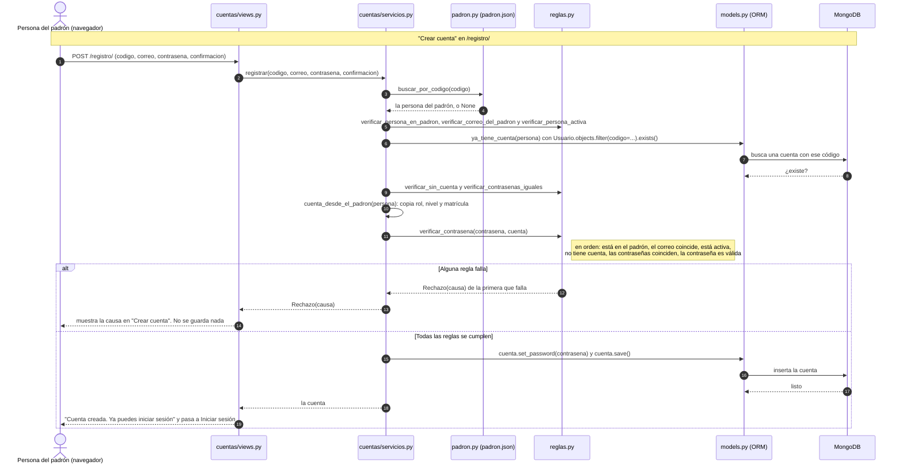
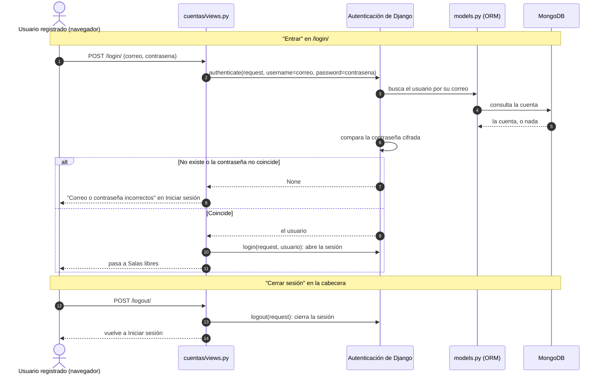
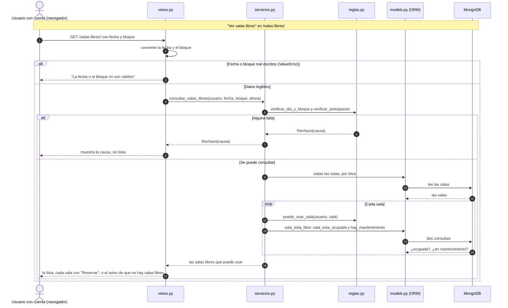
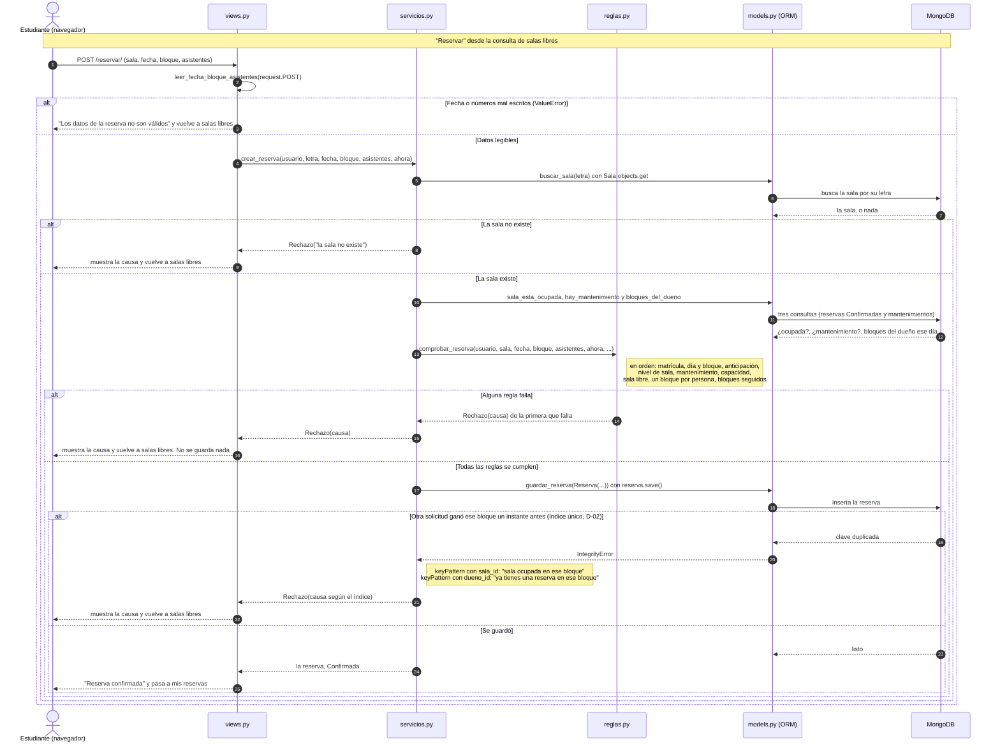
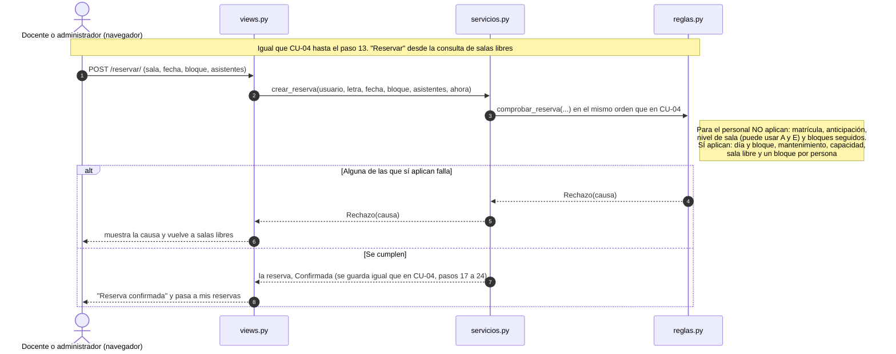
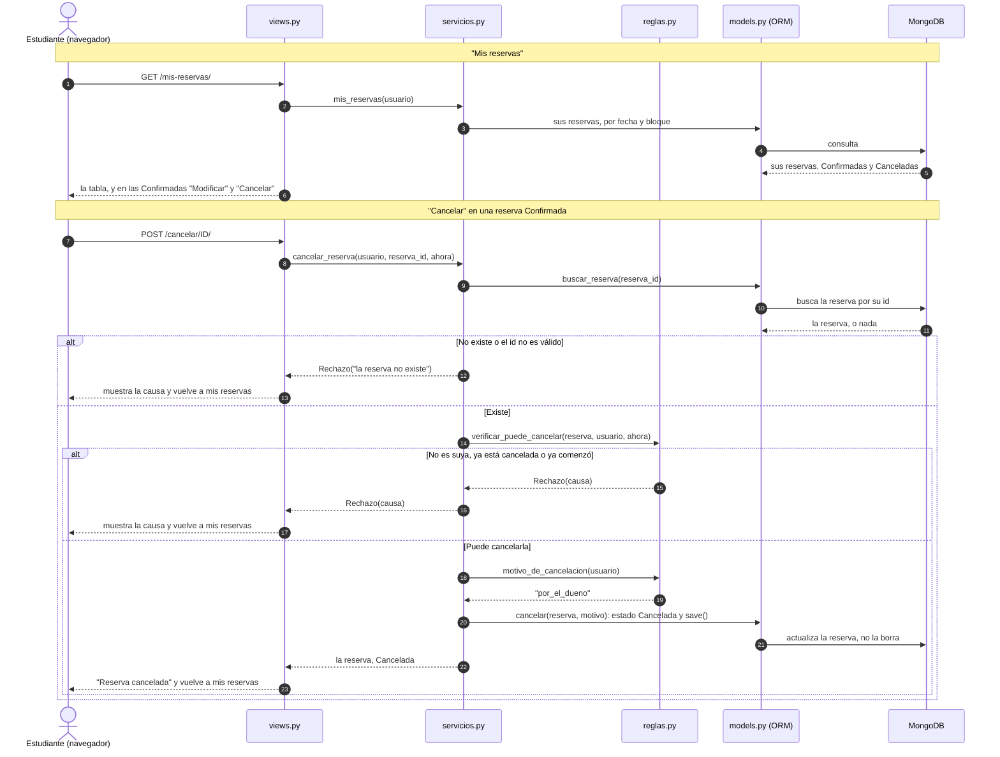
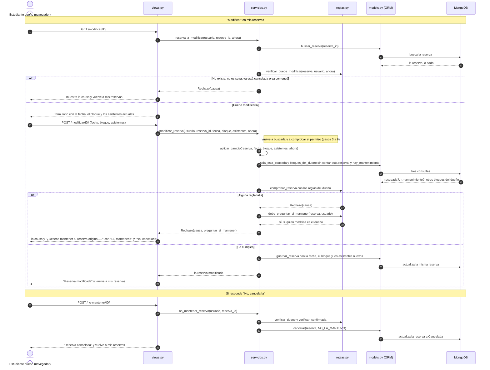
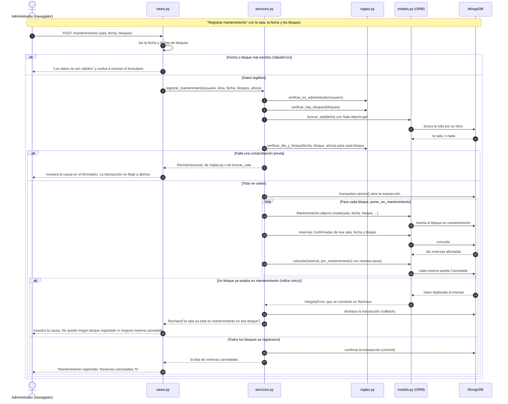
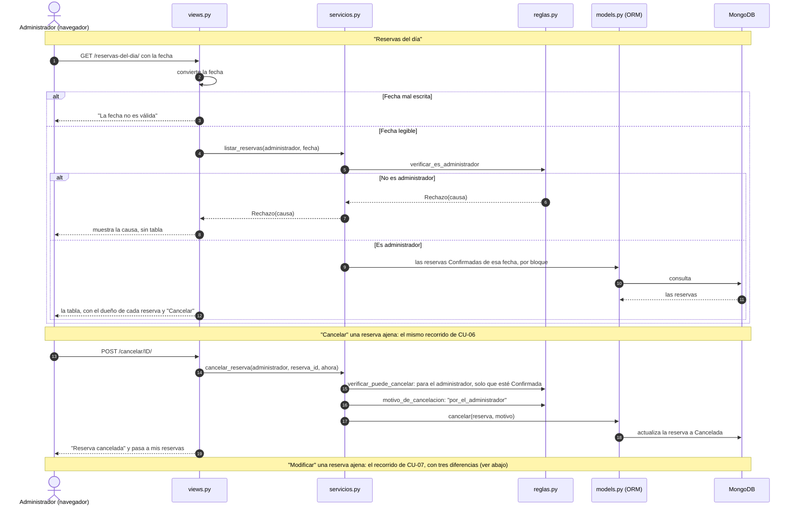

# Diagramas de secuencia de los casos de uso

- Proyecto: Reserva de Salas de Estudio — UPB Santa Cruz (P02)
- Integrantes que participan: Raúl Vaca y Hugo Zúñiga
- Fecha: 19/10/2026 (CU-04 y CU-08) · 29/10/2026 (CU-01 a CU-03, CU-05 a CU-07 y CU-09) · Fases 9 y 10 · Issue #25
- Diseño: [Sesiones 13–14](sesion-13-14-diseno.md) (secuencia de CU-07 en la sección 6.1) · Casos de uso: [Sesión 7](sesion-07-modelos.md), sección 3

Estos diagramas siguen el **código real** de `main` (`a6720cc`), no el diseño ideal. Cada flecha numerada tiene su línea de código en la tabla que la acompaña. Los de CU-04 y CU-08 se escribieron sobre `e5d808f`; sus líneas siguen siendo correctas en `a6720cc`. Los participantes son los archivos del código: `views.py` recibe la petición, `servicios.py` hace la operación, `reglas.py` decide y `models.py` es el ORM de Django, que convierte cada llamada en una lectura o escritura en MongoDB.

| Caso de uso | Sección | Vista (entrada) | Lógica principal |
|---|---|---|---|
| CU-01 Registrarse | [1](#1-cu-01--registrarse) | `cuentas/views.py` · `registrarse` | `cuentas/servicios.py` · `registrar` |
| CU-02 Iniciar y cerrar sesión | [2](#2-cu-02--iniciar-y-cerrar-sesión) | `iniciar_sesion` · `cerrar_sesion` | Autenticación de Django |
| CU-03 Consultar salas libres | [3](#3-cu-03--consultar-salas-libres) | `reservas/views.py` · `salas_libres` | `consultar_salas_libres` |
| CU-04 Reservar una sala | [4](#4-cu-04--reservar-una-sala) | `reservar` | `crear_reserva` |
| CU-05 Reserva del personal | [5](#5-cu-05--reserva-del-personal) | `reservar` | `crear_reserva`, con las reglas del personal |
| CU-06 Ver mis reservas y cancelar una | [6](#6-cu-06--ver-mis-reservas-y-cancelar-una) | `ver_mis_reservas` · `cancelar` | `mis_reservas` · `cancelar_reserva` |
| CU-07 Modificar mi reserva | [7](#7-cu-07--modificar-mi-reserva) | `modificar` · `no_mantener` | `modificar_reserva` · `no_mantener_reserva` |
| CU-08 Poner una sala en mantenimiento | [8](#8-cu-08--poner-una-sala-en-mantenimiento) | `mantenimiento` | `registrar_mantenimiento` |
| CU-09 Gestionar reservas ajenas | [9](#9-cu-09--gestionar-reservas-ajenas) | `reservas_del_dia` · `cancelar` · `modificar` | `listar_reservas` · `cancelar_reserva` · `modificar_reserva` |

En pantalla, desde C-16, los bloques se llaman "Horario A" a "Horario F". En el código y en estos diagramas siguen siendo el número del bloque (1 a 6).

## 1. CU-01 — Registrarse

El registro es la única operación que lee el padrón. Recorrido acordado: FE → MW → Padrón → BD.

| Paso | Qué pasa | Dónde está en el código |
|---|---|---|
| — | Sin POST, solo muestra el formulario | `cuentas/views.py`, líneas 9–10 y 23 (`registrarse`) |
| 1 | El navegador envía el formulario | `cuentas/views.py`, líneas 9–10; la ruta está en `cuentas/urls.py`, línea 6 |
| 2 | Llama al servicio con los cuatro datos | `views.py`, líneas 12–17; el servicio está en `cuentas/servicios.py`, línea 20 |
| 3–4 | Busca el código en el padrón, solo leyendo | `servicios.py`, línea 21; `buscar_por_codigo` está en `cuentas/padron.py`, líneas 13–17, y lee el archivo en las líneas 8–10 |
| 5 | Reglas del padrón | `servicios.py`, líneas 22–24; en `reservas/reglas.py`, líneas 191–193, 196–198 y 201–203 |
| 6–8 | ¿Ya tiene cuenta? | `servicios.py`, línea 25, que llama a `ya_tiene_cuenta` (líneas 7–8) |
| 9 | Sin cuenta y contraseñas iguales (C-15) | `servicios.py`, líneas 25–26; `reglas.py`, líneas 206–208 y 211–213 |
| 10 | Arma la cuenta con los datos del padrón | `servicios.py`, línea 27; `cuenta_desde_el_padron` está en las líneas 10–18 |
| 11 | Valida la contraseña con las reglas de Django | `servicios.py`, línea 28; `reglas.py`, líneas 216–220 |
| 12–13 | La primera regla que falla lanza `Rechazo` | La línea `raise Rechazo(...)` de esa función; la clase está en `reglas.py`, líneas 20–24 |
| 14 | La vista muestra la causa | `views.py`, líneas 18–19, y vuelve al formulario en la línea 23 |
| 15–17 | Cifra la contraseña y guarda la cuenta | `servicios.py`, líneas 29–30 |
| 18 | Devuelve la cuenta | `servicios.py`, línea 31 |
| 19 | Mensaje de éxito | `views.py`, líneas 20–22 |

**Cómo leerlo:**
- **El padrón solo se lee (pasos 3 y 4):** `padron.py` abre `padron/padron.json` y nunca escribe. Por eso el registro no lo cambia (HU01-CA1).
- **El rechazo puede salir en los pasos 5, 9 u 11.** El dibujo lo muestra una sola vez al final para que se lea mejor. En el código, la primera regla que falla corta ahí y no sigue.
- **La confirmación de la contraseña (C-15)** se comprueba después de las reglas del padrón y antes de validar la contraseña (paso 9).
- **El correo se compara sin distinguir mayúsculas** (`reglas.py`, línea 197) y se guarda normalizado (`servicios.py`, línea 12).

## 2. CU-02 — Iniciar y cerrar sesión

Aquí no participan `servicios.py` ni `reglas.py`: la autenticación es la de Django. Nuestro código solo le indica que el nombre de usuario es el correo. Recorrido acordado: FE → MW → BD, sin el padrón.

| Paso | Qué pasa | Dónde está en el código |
|---|---|---|
| 1 | El navegador envía el formulario | `cuentas/views.py`, líneas 26–27 (`iniciar_sesion`); la ruta está en `cuentas/urls.py`, línea 7 |
| 2 | Pide a Django que autentique | `views.py`, línea 28; en Django, `ModelBackend.authenticate` (`backends.py`, línea 59) |
| 3–5 | Busca el usuario por su correo | `backends.py`, línea 65 (`get_by_natural_key`); el correo es el nombre de usuario por `USERNAME_FIELD` (`cuentas/models.py`, línea 29) |
| 6 | Compara la contraseña | `backends.py`, línea 71 (`check_password` y `user_can_authenticate`) |
| 7 | No hay usuario | `backends.py`, líneas 66–69 si el correo no existe, o la línea 71 si la contraseña no coincide |
| 8 | Mensaje único | `views.py`, líneas 32–33 |
| 9 | Devuelve el usuario | `backends.py`, líneas 71–72 |
| 10 | Abre la sesión | `views.py`, líneas 29–30 |
| 11 | Pasa a Salas libres | `views.py`, línea 31 |
| 12 | Cerrar sesión, solo por POST | `views.py`, líneas 36–37 (`@require_POST`, `cerrar_sesion`); la ruta está en `cuentas/urls.py`, línea 8 |
| 13 | Cierra la sesión | `views.py`, línea 38 |
| 14 | Vuelve a Iniciar sesión | `views.py`, línea 39 |

**Cómo leerlo:**
- **El mensaje es uno solo (RF-14):** si el correo no existe y si la contraseña no coincide, Django devuelve lo mismo, `None` (paso 7), y la vista no puede distinguirlos.
- **Aunque el correo no exista, Django calcula una contraseña cifrada de todos modos** (`backends.py`, líneas 66–69), para que las dos respuestas tarden lo mismo.
- Las líneas de `backends.py` son las del archivo `django/contrib/auth/backends.py` de Django 5.2.18 instalado, no de nuestro código.

## 3. CU-03 — Consultar salas libres

| Paso | Qué pasa | Dónde está en el código |
|---|---|---|
| — | Sin fecha en la dirección (primera visita), solo muestra el formulario, con la fecha de hoy ya puesta (`a6372d0`) | `reservas/views.py`, líneas 22–23 y 32–33 |
| 1 | El navegador pide la consulta | `reservas/views.py`, líneas 20–23 (`salas_libres`); la ruta está en `reservas/urls.py`, línea 6 |
| 2 | Convierte la fecha y el bloque | `views.py`, líneas 25–26 |
| 3 | Datos ilegibles | `views.py`, líneas 30–31 |
| 4 | Llama al servicio, con la hora real como `ahora` | `views.py`, línea 27; el servicio está en `reservas/servicios.py`, línea 95 |
| 5 | Día de atención, bloque y anticipación | `servicios.py`, líneas 96–97; `reglas.py`, líneas 84–90 y 108–117 |
| 6–7 | La regla que falla lanza `Rechazo` | La línea `raise Rechazo(...)` de esa función |
| 8 | La vista muestra la causa | `views.py`, líneas 28–29 y 32–33 |
| 9–11 | Lee todas las salas | `servicios.py`, línea 100 |
| 12 | ¿Puede usar esa sala? | `servicios.py`, línea 101; `reglas.py`, líneas 53–56 |
| 13–15 | ¿Está libre? | `servicios.py`, línea 101, que llama a `sala_esta_libre` (90–93), y esta a `sala_esta_ocupada` (14–20) y a `hay_mantenimiento` (22–23) |
| 16 | Devuelve la lista | `servicios.py`, líneas 98–102 |
| 17 | Muestra la lista | `views.py`, líneas 32–33 |

**Cómo leerlo:**
- **Consultar no escribe nada (RC-02):** todas las flechas hacia MongoDB son lecturas.
- **Las dos consultas de cada sala (pasos 13 a 15) solo se hacen si la persona puede usarla:** el `and` de `servicios.py`, línea 101, corta antes. Por eso pregrado nunca ve las salas A y E.
- **Son las mismas reglas de día, bloque y anticipación que al reservar (CU-04)**, así que la lista solo muestra lo que de verdad se puede reservar.

## 4. CU-04 — Reservar una sala

| Paso | Qué pasa | Dónde está en el código |
|---|---|---|
| — | La vista exige POST y sesión iniciada | `reservas/views.py`, líneas 36–37 (`@require_POST`, `@login_required`) |
| 1 | El navegador envía el formulario | `reservas/views.py`, línea 38 (`reservar`) |
| 2 | Convierte fecha, bloque y asistentes | `views.py`, línea 40; la función está en las líneas 16–17 |
| 3 | Datos ilegibles | `views.py`, líneas 45–47 |
| 4 | Llama al servicio, con la hora real como `ahora` | `views.py`, línea 41 (`timezone.localtime()`); el servicio está en `reservas/servicios.py`, línea 44 |
| 5–7 | Busca la sala por su letra | `servicios.py`, línea 45, que llama a `buscar_sala` (líneas 8–12) |
| 8 | La sala no existe | `servicios.py`, líneas 11–12 |
| 9 | La vista muestra la causa | `views.py`, líneas 42–44 |
| 10–12 | Lee lo que necesitan las reglas | `servicios.py`, líneas 48–50, que llaman a `sala_esta_ocupada` (14–20), `hay_mantenimiento` (22–23) y `bloques_del_dueno` (25–31) |
| 13 | Pregunta a las reglas | `servicios.py`, líneas 46–51; `comprobar_reserva` está en `reservas/reglas.py`, líneas 127–139 |
| Nota | Orden de las reglas | `reglas.py`: matrícula 131 (función 48–50), día y bloque 132 (84–90), anticipación 133 (108–117), nivel 134 (59–61), mantenimiento 135 (64–66), capacidad 136 (27–31), sala libre 137 (34–36), un bloque por persona 138 (39–41), bloques seguidos 139 (120–124) |
| 14 | La primera regla que falla lanza `Rechazo` | La línea `raise Rechazo(...)` de esa función; la clase `Rechazo` está en `reglas.py`, líneas 20–24 |
| 15–16 | La vista muestra la causa | `views.py`, líneas 42–44 (`messages.error(request, rechazo.causa)`) |
| 17–18 | Crea y guarda la reserva | `servicios.py`, líneas 52–55; `guardar_reserva` está en las líneas 33–35 |
| 19–20 | Falla el índice único | `servicios.py`, línea 36 (`except IntegrityError`) |
| Nota | Elige la causa según el índice | `servicios.py`, líneas 37–41 |
| 21–22 | La vista muestra la causa | `views.py`, líneas 42–44 |
| 23–24 | Guardada | `servicios.py`, línea 56 (`return reserva`) |
| 25 | Mensaje de éxito | `views.py`, líneas 48–49 |

**Cómo leerlo:**
- **`views.py` no decide nada:** convierte el formulario, llama a `crear_reserva` y muestra lo que vuelva, sea la reserva o la causa del `Rechazo`.
- **`servicios.py` lee antes de preguntar:** las tres consultas de los pasos 10 a 12 se hacen **antes** de llamar a `comprobar_reserva`, porque `reglas.py` no toca la base.
- **El índice único (pasos 19 a 22) es la última barrera** para el mismo instante. En el uso normal, la regla rechaza antes, en el paso 14.
- **Si el `IntegrityError` no viene de ninguno de los dos índices**, `guardar_reserva` lo relanza (`servicios.py`, línea 42) y no se convierte en `Rechazo`. Ese caso no se dibuja.

## 5. CU-05 — Reserva del personal

Es el **mismo recorrido de CU-04**: la misma vista (`reservar`), el mismo servicio (`crear_reserva`) y las mismas lecturas y escrituras. Lo único que cambia está dentro de `comprobar_reserva`: para docente y administrador, cuatro reglas no aplican. Este diagrama dibuja solo esa diferencia.

| Paso | Qué pasa | Dónde está en el código |
|---|---|---|
| 1 | El navegador envía el formulario | `reservas/views.py`, líneas 36–38 (`reservar`) |
| 2 | Llama al mismo servicio que CU-04 | `views.py`, línea 41; `reservas/servicios.py`, línea 44 |
| 3 | Pregunta a las reglas | `servicios.py`, líneas 46–51; `comprobar_reserva` está en `reglas.py`, líneas 127–139 |
| Nota | Matrícula: solo se exige a estudiantes | `reglas.py`, líneas 48–50 (`es_estudiante` está en 44–45) |
| Nota | Anticipación: el personal no tiene límite | `reglas.py`, líneas 108–110 (`return` si no es estudiante) |
| Nota | Nivel de sala: el personal puede usar A y E | `reglas.py`, líneas 53–56 (`puede_usar_sala` devuelve `True`), usada en 59–61 |
| Nota | Bloques seguidos: solo para estudiantes | `reglas.py`, líneas 120–122 |
| 4–5 | La regla que falla lanza `Rechazo` | La línea `raise Rechazo(...)` de esa función |
| 6 | La vista muestra la causa | `views.py`, líneas 42–44 |
| 7 | Guarda la reserva | `servicios.py`, líneas 52–56 (mismo camino que CU-04) |
| 8 | Mensaje de éxito | `views.py`, líneas 48–49 |

**Cómo leerlo:**
- **No hay una vista ni un servicio aparte para el personal.** La diferencia está en cuatro reglas que preguntan por el rol y no hacen nada si no es estudiante.
- **En la consulta de salas libres (CU-03, paso 12)** el personal ve también las salas A y E, por la misma función `puede_usar_sala`.

## 6. CU-06 — Ver mis reservas y cancelar una

| Paso | Qué pasa | Dónde está en el código |
|---|---|---|
| 1 | El navegador pide sus reservas | `reservas/views.py`, líneas 52–53 (`ver_mis_reservas`); la ruta está en `reservas/urls.py`, línea 8 |
| 2 | Llama al servicio | `views.py`, línea 54; `reservas/servicios.py`, línea 81 |
| 3–5 | Lee todas sus reservas | `servicios.py`, línea 82 |
| 6 | Muestra la tabla | `views.py`, línea 54 |
| 7 | Pulsa Cancelar | `views.py`, líneas 57–59 (`@require_POST`, `@login_required`, `cancelar`); la ruta está en `urls.py`, línea 9 |
| 8 | Llama al servicio, con la hora real como `ahora` | `views.py`, línea 61; `servicios.py`, línea 70 |
| 9–11 | Busca la reserva | `servicios.py`, línea 71, que llama a `buscar_reserva` (líneas 58–62) |
| 12 | No existe o el id es inválido | `servicios.py`, líneas 61–62 |
| 13, 17 | La vista muestra la causa | `views.py`, líneas 62–63 y 66 |
| 14 | ¿Puede cancelarla? | `servicios.py`, línea 72; `reglas.py`, líneas 172–178 |
| 15–16 | Falla una comprobación | `reglas.py`: dueño en 176 (función 160–162), confirmada en 177 (155–157) y no comenzada en 178 (79–81) |
| 18–19 | Elige el motivo | `servicios.py`, línea 73; `reglas.py`, líneas 181–184 |
| 20–21 | Cancela y guarda | `servicios.py`, línea 73, que llama a `cancelar` (líneas 64–68) |
| 22 | Devuelve la reserva | `servicios.py`, línea 68 |
| 23 | Mensaje de éxito | `views.py`, líneas 64–66 |

**Cómo leerlo:**
- **El registro se conserva (pasos 26 y 27):** `cancelar` cambia el estado y el motivo y guarda. Nunca borra (HU06-CA1). Por eso Mis reservas muestra también las canceladas, con su motivo.
- **"Ya comenzó" significa hora actual igual o posterior al inicio del bloque** (`reglas.py`, líneas 75–76): a la hora exacta de inicio ya no se puede cancelar (HU06-CA2).
- **El orden importa:** primero se comprueba que sea suya, así que una reserva ajena se rechaza con "la reserva no es tuya" aunque ya haya comenzado (HU06-CA3).

## 7. CU-07 — Modificar mi reserva

El diseño tiene la secuencia ideal de CU-07 en [Sesiones 13–14](sesion-13-14-diseno.md), sección 6.1. Este diagrama sigue el código real.

| Paso | Qué pasa | Dónde está en el código |
|---|---|---|
| 1 | Abre el formulario | `reservas/views.py`, líneas 69–70 (`modificar`); la ruta está en `reservas/urls.py`, línea 10 |
| 2 | Pide la reserva con su permiso | `views.py`, líneas 71–73; `reservas/servicios.py`, líneas 118–121 |
| 3–5 | Busca la reserva | `servicios.py`, línea 119, que llama a `buscar_reserva` (58–62) |
| 6 | ¿Puede modificarla? | `servicios.py`, línea 120; `reglas.py`, líneas 165–169 |
| 7 | No puede | La línea `raise Rechazo(...)` de la función que falló |
| 8 | La vista muestra la causa | `views.py`, líneas 74–76 |
| 9 | Muestra el formulario | `views.py`, líneas 77 y 90–91 |
| 10 | Envía el cambio | `views.py`, líneas 78–80 |
| 11 | Llama al servicio | `views.py`, línea 81; `servicios.py`, líneas 123–124 |
| 12 | Aplica el cambio | `servicios.py`, línea 126; `aplicar_cambio` está en las líneas 104–116 |
| 13–15 | Lee lo que necesitan las reglas, sin contar esta reserva | `servicios.py`, líneas 109–111 (`excepto=reserva`) |
| 16 | Pregunta a las reglas, con el dueño | `servicios.py`, líneas 105 y 107–112; `reglas.py`, líneas 127–139 |
| 17 | La primera regla que falla lanza `Rechazo` | La línea `raise Rechazo(...)` de esa función |
| 18–19 | ¿Se pregunta si mantenerla? | `servicios.py`, líneas 127–128; `reglas.py`, líneas 187–188 |
| 20 | Relanza el rechazo con la pregunta | `servicios.py`, línea 129 |
| 21 | La vista muestra la causa y la pregunta | `views.py`, líneas 82–84 y 90–91 |
| 22–23 | Guarda la misma reserva | `servicios.py`, líneas 113–116; `guardar_reserva` está en las líneas 33–42 |
| 24 | Devuelve la reserva | `servicios.py`, línea 130 |
| 25 | Mensaje de éxito | `views.py`, líneas 87–89 |
| 26 | Responde que no | `views.py`, líneas 94–96 (`no_mantener`); la ruta está en `urls.py`, línea 11 |
| 27 | Llama al servicio | `views.py`, línea 98; `servicios.py`, líneas 75–76 |
| 28 | Solo el dueño y solo si sigue Confirmada | `servicios.py`, líneas 77–78; `reglas.py`, líneas 160–162 y 155–157 |
| 29–30 | Cancela con el motivo "no la mantuvo" | `servicios.py`, línea 79, que llama a `cancelar` (64–68) |
| 31 | Mensaje de éxito | `views.py`, líneas 99–103 |

**Cómo leerlo:**
- **"Sí, mantenerla" no llama a la lógica:** es un enlace a mis reservas. La reserva quedó intacta porque el paso 16 rechazó antes de escribir (HU07-CA2).
- **Se modifica la misma reserva:** `aplicar_cambio` cambia los campos de la reserva que ya existe y la guarda. No crea otra (HU07-CA1).
- **"Sin contar esta reserva" (`excepto=reserva`)** evita que la reserva choque consigo misma al revisar si la sala está ocupada o si hay bloques seguidos.
- **La pregunta solo aparece para el dueño (pasos 18 y 19).** Para el administrador, `debe_preguntar_si_mantener` devuelve `False` (CU-09).
- **No se dibujan dos caminos:** los datos mal escritos (`views.py`, líneas 85–86) y el índice único al guardar (`servicios.py`, líneas 36–41), que funciona igual que en CU-04.

## 8. CU-08 — Poner una sala en mantenimiento

| Paso | Qué pasa | Dónde está en el código |
|---|---|---|
| — | La vista exige sesión iniciada | `reservas/views.py`, línea 118 (`@login_required`) |
| 1 | El navegador envía el formulario | `views.py`, líneas 119–120 (`mantenimiento`, `if request.method == "POST"`) |
| 2 | Convierte la fecha y los bloques | `views.py`, líneas 122–123 |
| 3 | Datos ilegibles | `views.py`, líneas 129–130; vuelve a mostrar el formulario en la línea 134 |
| 4 | Llama al servicio, con la hora real como `ahora` | `views.py`, líneas 124–126; el servicio está en `reservas/servicios.py`, línea 147 |
| 5 | Comprueba que sea administrador | `servicios.py`, línea 148; `reglas.py`, líneas 150–152 |
| 6 | Comprueba que haya al menos un bloque | `servicios.py`, línea 149; `reglas.py`, líneas 223–225 (según `ed35945`) |
| 7–9 | Busca la sala | `servicios.py`, línea 150; `buscar_sala` está en las líneas 8–12 |
| 10 | Comprueba cada bloque: día de atención, que exista y que no haya empezado | `servicios.py`, líneas 151–152; `reglas.py`, líneas 84–90 |
| 11–12 | Rechazo antes de la transacción | La línea `raise` de la función que falló; la vista lo muestra en `views.py`, líneas 127–128, y vuelve al formulario en la línea 134 |
| 13 | Abre la transacción | `servicios.py`, línea 154 (`with transaction.atomic()`), importada en la línea 3 desde `django_mongodb_backend`. Dentro del conector: `transaction.py`, líneas 22–29 (`start_transaction_mongo`) |
| 14–15 | Registra el bloque | `servicios.py`, líneas 155–156, que llaman a `poner_en_mantenimiento` (132); el `create`, líneas 133–137 |
| 16–18 | Busca las reservas afectadas | `servicios.py`, líneas 140–144 |
| 19–20 | Las cancela | `servicios.py`, línea 145, que llama a `cancelar` (líneas 64–68) |
| 21–22 | El bloque ya estaba registrado | `servicios.py`, líneas 138–139 (`except IntegrityError` y `raise Rechazo(...)`) |
| 23 | Rollback | Lo hace el conector al salir del `with` con una excepción: `transaction.py`, líneas 32 y 49–53 (`rollback_mongo`) |
| 24–25 | La vista muestra la causa | `views.py`, líneas 127–128 y 134 |
| 26 | Commit | El conector, al salir del `with` sin excepción: `transaction.py`, líneas 40–45 (`commit_mongo`) |
| 27 | Devuelve las reservas canceladas | `servicios.py`, línea 157 |
| 28 | Mensaje de éxito | `views.py`, líneas 131–133 |

Las líneas de `transaction.py` son las del archivo `django_mongodb_backend/transaction.py` de la versión 5.2.4 instalada, no de nuestro código.

**Cómo leerlo:**
- **Todo lo que puede rechazarse sin escribir se comprueba antes de abrir la transacción** (pasos 5 a 10): rol, bloques, sala y cada bloque.
- **Dentro de la transacción (pasos 13 a 26) se escribe:** el registro de cada bloque y la cancelación de sus reservas. Si un bloque ya estaba registrado, el `Rechazo` sale del `with` y el conector deshace todo lo escrito, también lo de los bloques anteriores (D-04, RC-03). Así lo probó Raúl en el navegador el 17/10 (`1d892c9`).
- **El dibujo muestra el fallo después del bucle para que se lea mejor.** En el código, el fallo ocurre en el bloque repetido y corta el bucle en ese punto.
- **Se usa `django_mongodb_backend.transaction`, no `django.db.transaction`:** con este conector, el `atomic()` de Django no hace nada (diseño, D-04).

## 9. CU-09 — Gestionar reservas ajenas

| Paso | Qué pasa | Dónde está en el código |
|---|---|---|
| 1 | El navegador pide las reservas del día | `reservas/views.py`, líneas 105–108 (`reservas_del_dia`); la ruta está en `reservas/urls.py`, línea 12 |
| 2 | Convierte la fecha | `views.py`, línea 110 |
| 3 | Fecha ilegible | `views.py`, líneas 114–116 |
| 4 | Llama al servicio | `views.py`, línea 111; `reservas/servicios.py`, línea 84 |
| 5 | ¿Es administrador? | `servicios.py`, línea 85; `reglas.py`, líneas 150–152 |
| 6–7 | No lo es | `reglas.py`, línea 152 |
| 8 | La vista muestra la causa | `views.py`, líneas 112–113 y 116 |
| 9–11 | Lee las reservas Confirmadas de esa fecha | `servicios.py`, líneas 86–88 |
| 12 | Muestra la tabla | `views.py`, línea 116 |
| 13 | Pulsa Cancelar | `views.py`, líneas 57–59 (`cancelar`) |
| 14 | Llama al mismo servicio de CU-06 | `views.py`, línea 61; `servicios.py`, líneas 70–71 |
| 15 | Al administrador solo se le exige que esté Confirmada | `servicios.py`, línea 72; `reglas.py`, líneas 172–175 |
| 16 | Motivo "por el administrador" | `servicios.py`, línea 73; `reglas.py`, líneas 181–183 |
| 17–18 | Cancela y guarda | `servicios.py`, líneas 64–68 |
| 19 | Mensaje de éxito | `views.py`, líneas 64–66 |

**Cómo leerlo:**
- **El administrador puede cancelar aunque la reserva ya haya comenzado:** para él, `verificar_puede_cancelar` solo comprueba que esté Confirmada (`reglas.py`, líneas 173–175).
- **Después de cancelar, la vista lleva a Mis reservas** (`views.py`, línea 66), no de vuelta a Reservas del día.
- **Modificar una reserva ajena sigue el recorrido de CU-07 con tres diferencias:** no se comprueba que sea suya (`reglas.py`, líneas 166–167); las reglas son las del dueño, porque `aplicar_cambio` usa `reserva.dueno` (`servicios.py`, línea 105, HU09-CA2); y no hay pregunta, porque `debe_preguntar_si_mantener` devuelve `False` (`reglas.py`, líneas 187–188, HU09-CA1).
- **La tabla de Reservas del día no tiene un enlace "Modificar":** el administrador llega al formulario por la dirección `/modificar/ID/`.
