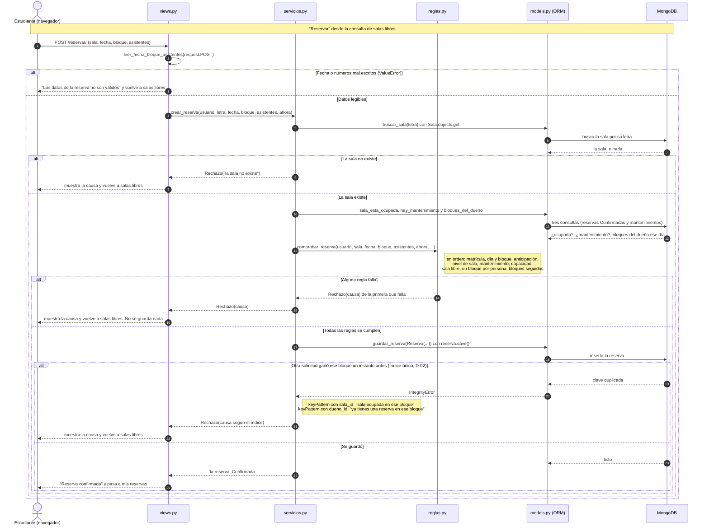
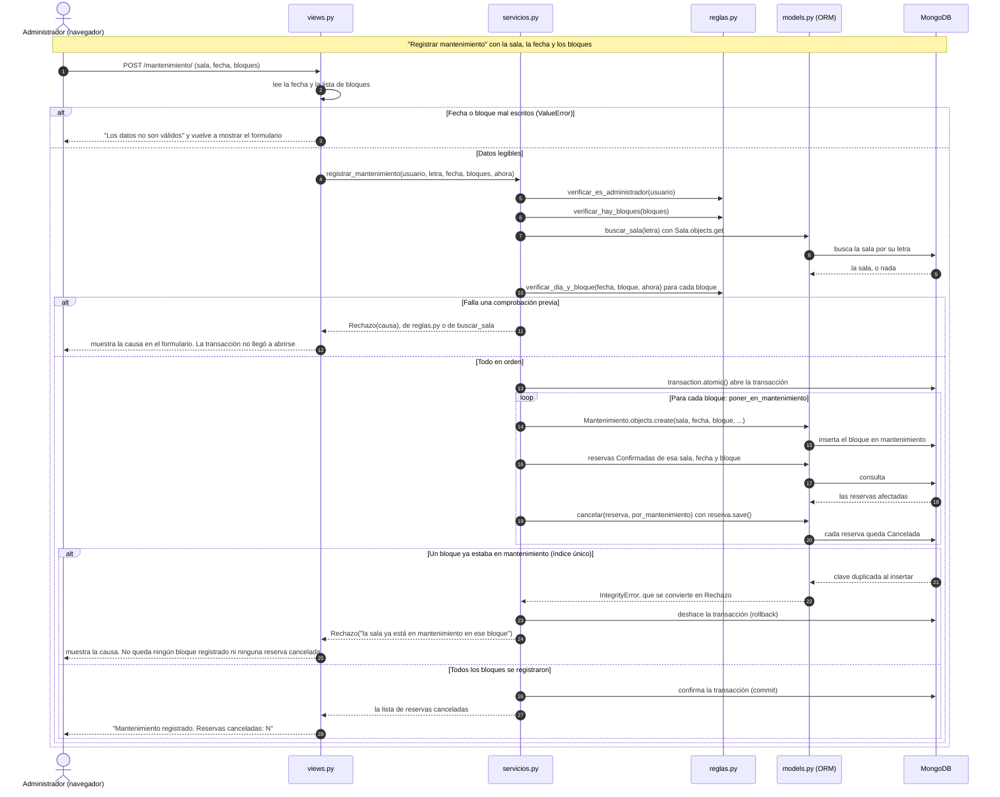

# Diagramas de secuencia — CU-04 y CU-08

- Proyecto: Reserva de Salas de Estudio — UPB Santa Cruz (P02)
- Integrantes que participan: Raúl Vaca y Hugo Zúñiga
- Fecha: 19/10/2026 · Fase 9 · Issue #25
- Diseño: [Sesiones 13–14](sesion-13-14-diseno.md) (secuencia de CU-07 en la sección 6.1) · Casos de uso: [Sesión 7](sesion-07-modelos.md), sección 3

Estos dos diagramas siguen el **código real** de `main` (`e5d808f`), no el diseño ideal. Cada flecha numerada tiene su línea de código en la tabla que la acompaña. Los participantes son los mismos del diagrama de CU-07, más `models.py`: es el ORM de Django, que convierte cada llamada en una lectura o escritura en MongoDB.

## 1. CU-04 — Reservar una sala

| Paso | Qué pasa | Dónde está en el código |
|---|---|---|
| — | La vista exige POST y sesión iniciada | `reservas/views.py`, líneas 36–37 (`@require_POST`, `@login_required`) |
| 1 | El navegador envía el formulario | `reservas/views.py`, línea 38 (`reservar`) |
| 2 | Convierte fecha, bloque y asistentes | `views.py`, línea 40; la función está en las líneas 16–17 |
| 3 | Datos ilegibles | `views.py`, líneas 45–47 |
| 4 | Llama al servicio, con la hora real como `ahora` | `views.py`, línea 41 (`timezone.localtime()`); el servicio está en `reservas/servicios.py`, línea 44 |
| 5–7 | Busca la sala por su letra | `servicios.py`, línea 45, que llama a `buscar_sala` (líneas 8–12) |
| 8 | La sala no existe | `servicios.py`, líneas 11–12 |
| 9 | La vista muestra la causa | `views.py`, líneas 42–44 |
| 10–12 | Lee lo que necesitan las reglas | `servicios.py`, líneas 48–50, que llaman a `sala_esta_ocupada` (14–20), `hay_mantenimiento` (22–23) y `bloques_del_dueno` (25–31) |
| 13 | Pregunta a las reglas | `servicios.py`, líneas 46–51; `comprobar_reserva` está en `reservas/reglas.py`, líneas 127–139 |
| Nota | Orden de las reglas | `reglas.py`: matrícula 131 (función 48–50), día y bloque 132 (84–90), anticipación 133 (108–117), nivel 134 (59–61), mantenimiento 135 (64–66), capacidad 136 (27–31), sala libre 137 (34–36), un bloque por persona 138 (39–41), bloques seguidos 139 (120–124) |
| 14 | La primera regla que falla lanza `Rechazo` | La línea `raise Rechazo(...)` de esa función; la clase `Rechazo` está en `reglas.py`, líneas 20–24 |
| 15–16 | La vista muestra la causa | `views.py`, líneas 42–44 (`messages.error(request, rechazo.causa)`) |
| 17–18 | Crea y guarda la reserva | `servicios.py`, líneas 52–55; `guardar_reserva` está en las líneas 33–35 |
| 19–20 | Falla el índice único | `servicios.py`, línea 36 (`except IntegrityError`) |
| Nota | Elige la causa según el índice | `servicios.py`, líneas 37–41 |
| 21–22 | La vista muestra la causa | `views.py`, líneas 42–44 |
| 23–24 | Guardada | `servicios.py`, línea 56 (`return reserva`) |
| 25 | Mensaje de éxito | `views.py`, líneas 48–49 |

**Cómo leerlo:**
- **`views.py` no decide nada:** convierte el formulario, llama a `crear_reserva` y muestra lo que vuelva, sea la reserva o la causa del `Rechazo`.
- **`servicios.py` lee antes de preguntar:** las tres consultas de los pasos 10 a 12 se hacen **antes** de llamar a `comprobar_reserva`, porque `reglas.py` no toca la base.
- **El índice único (pasos 19 a 22) es la última barrera** para el mismo instante. En el uso normal, la regla rechaza antes, en el paso 14.
- **Si el `IntegrityError` no viene de ninguno de los dos índices**, `guardar_reserva` lo relanza (`servicios.py`, línea 42) y no se convierte en `Rechazo`. Ese caso no se dibuja.

## 2. CU-08 — Poner una sala en mantenimiento

| Paso | Qué pasa | Dónde está en el código |
|---|---|---|
| — | La vista exige sesión iniciada | `reservas/views.py`, línea 118 (`@login_required`) |
| 1 | El navegador envía el formulario | `views.py`, líneas 119–120 (`mantenimiento`, `if request.method == "POST"`) |
| 2 | Convierte la fecha y los bloques | `views.py`, líneas 122–123 |
| 3 | Datos ilegibles | `views.py`, líneas 129–130; vuelve a mostrar el formulario en la línea 134 |
| 4 | Llama al servicio, con la hora real como `ahora` | `views.py`, líneas 124–126; el servicio está en `reservas/servicios.py`, línea 147 |
| 5 | Comprueba que sea administrador | `servicios.py`, línea 148; `reglas.py`, líneas 150–152 |
| 6 | Comprueba que haya al menos un bloque | `servicios.py`, línea 149; `reglas.py`, líneas 223–225 (según `ed35945`) |
| 7–9 | Busca la sala | `servicios.py`, línea 150; `buscar_sala` está en las líneas 8–12 |
| 10 | Comprueba cada bloque: día de atención, que exista y que no haya empezado | `servicios.py`, líneas 151–152; `reglas.py`, líneas 84–90 |
| 11–12 | Rechazo antes de la transacción | La línea `raise` de la función que falló; la vista lo muestra en `views.py`, líneas 127–128, y vuelve al formulario en la línea 134 |
| 13 | Abre la transacción | `servicios.py`, línea 154 (`with transaction.atomic()`), importada en la línea 3 desde `django_mongodb_backend`. Dentro del conector: `transaction.py`, líneas 22–29 (`start_transaction_mongo`) |
| 14–15 | Registra el bloque | `servicios.py`, líneas 155–156, que llaman a `poner_en_mantenimiento` (132); el `create`, líneas 133–137 |
| 16–18 | Busca las reservas afectadas | `servicios.py`, líneas 140–144 |
| 19–20 | Las cancela | `servicios.py`, línea 145, que llama a `cancelar` (líneas 64–68) |
| 21–22 | El bloque ya estaba registrado | `servicios.py`, líneas 138–139 (`except IntegrityError` y `raise Rechazo(...)`) |
| 23 | Rollback | Lo hace el conector al salir del `with` con una excepción: `transaction.py`, líneas 32 y 49–53 (`rollback_mongo`) |
| 24–25 | La vista muestra la causa | `views.py`, líneas 127–128 y 134 |
| 26 | Commit | El conector, al salir del `with` sin excepción: `transaction.py`, líneas 40–45 (`commit_mongo`) |
| 27 | Devuelve las reservas canceladas | `servicios.py`, línea 157 |
| 28 | Mensaje de éxito | `views.py`, líneas 131–133 |

Las líneas de `transaction.py` son las del archivo `django_mongodb_backend/transaction.py` de la versión 5.2.4 instalada, no de nuestro código.

**Cómo leerlo:**
- **Todo lo que puede rechazarse sin escribir se comprueba antes de abrir la transacción** (pasos 5 a 10): rol, bloques, sala y cada bloque.
- **Dentro de la transacción (pasos 13 a 26) se escribe:** el registro de cada bloque y la cancelación de sus reservas. Si un bloque ya estaba registrado, el `Rechazo` sale del `with` y el conector deshace todo lo escrito, también lo de los bloques anteriores (D-04, RC-03). Así lo probó Raúl en el navegador el 17/10 (`1d892c9`).
- **El dibujo muestra el fallo después del bucle para que se lea mejor.** En el código, el fallo ocurre en el bloque repetido y corta el bucle en ese punto.
- **Se usa `django_mongodb_backend.transaction`, no `django.db.transaction`:** con este conector, el `atomic()` de Django no hace nada (diseño, D-04).
