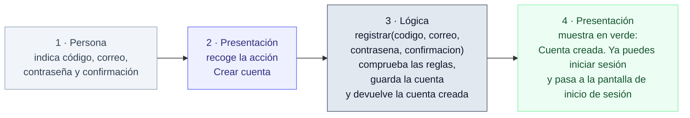
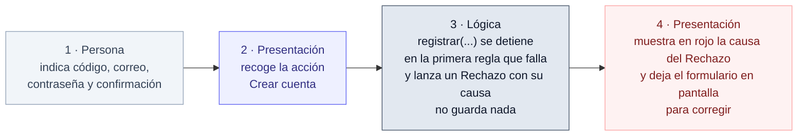

# Registro: recorrido de la acción (HU-01 / CU-01)

## Recorrido de la acción

### Cuando el registro se acepta

- **Paso 2:** `cuentas/views.py`, función `registrarse`, líneas 9–17.
- **Paso 3:** `cuentas/servicios.py`, función `registrar`, líneas 20–31.
- **Paso 4:** `cuentas/views.py`, líneas 20–22. La vista guarda el mensaje de éxito y redirige al inicio de sesión, donde se muestra (`templates/base.html`, líneas 31–32).

**Qué devuelve la lógica:** la cuenta creada. La vista no la usa para nada más.

**Qué muestra la presentación:** el mensaje **Cuenta creada. Ya puedes iniciar sesión**, en un recuadro verde, y lleva a la persona a la pantalla de inicio de sesión.

### Cuando el registro se rechaza

- **Paso 2:** `cuentas/views.py`, función `registrarse`, líneas 9–17.
- **Paso 3:** `cuentas/servicios.py`, líneas 21–28. Las comprobaciones están en `reservas/reglas.py`, líneas 191–220.
- **Paso 4:** `cuentas/views.py`, líneas 18–19 (guarda la causa como mensaje de error) y 23 (vuelve a mostrar el formulario). El mensaje se pinta en rojo en `templates/base.html`, líneas 31–32.

**Qué devuelve la lógica:** nada. Lanza un `Rechazo` con la causa de la primera regla que falla, y no se guarda ninguna cuenta.

**Qué muestra la presentación:** la causa concreta, en un recuadro rojo sobre el mismo formulario. Según la regla que falle, será una de estas:

- **código no encontrado en el padrón**
- **el correo no corresponde a ese código**
- **persona no activa en el padrón**
- **ya tienes una cuenta**
- **las contraseñas no coinciden** (C-15)
- el mensaje de Django, en español, cuando la contraseña no cumple las reglas de seguridad (muy corta, muy común, solo números o parecida al nombre o al correo)

Se comprueban en ese orden, y solo se muestra la primera que falla.
