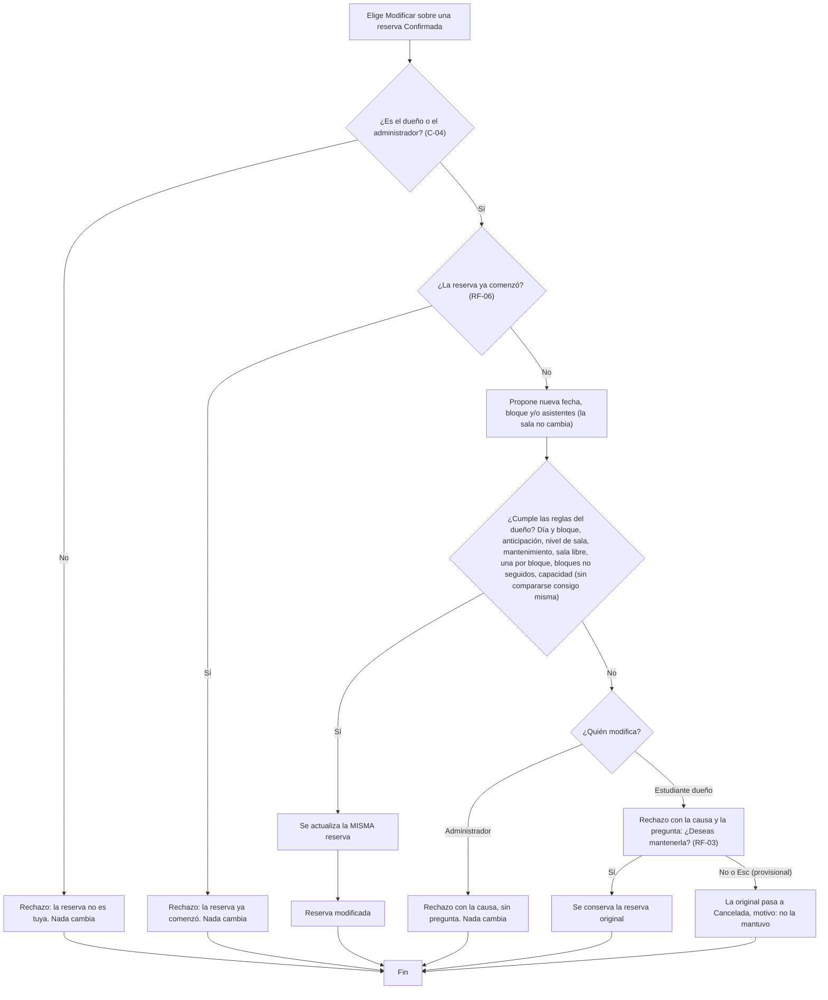
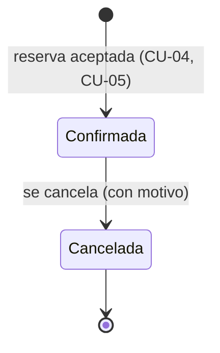

# Sesión 7 — Historias, casos de uso y modelos

- Proyecto: Reserva de Salas de Estudio — UPB Santa Cruz (P02)
- Integrantes que participan: Raúl Vaca (Hugo Zúñiga se incorpora en la fase 7)
- Fecha: 15/10/2026 · Fase 1 · Issue #3 · Milestone F1 Requisitos
- Requisitos de origen: [Sesión 6](sesion-06-requisitos.md) · Cambios: [cambios.md](cambios.md) · Plan: [Sesiones 8–9](sesion-08-09-plan.md)

## 0. Cómo leer este documento

- Los datos de los ejemplos son los de la sección 0 de los requisitos: bloques B1 a B6, personas ficticias, salas y capacidades. Las marcas **[ACUERDO]**, **[PROPUESTA]** y **[PROVISIONAL]** de cada regla están en los requisitos, y aquí se citan por su ID.
- **Cada criterio de aceptación es exactamente un test.** Hay 26 criterios, así que habrá 26 tests. El nombre de cada test empieza con su historia y su criterio (`test_HU04_CA2_…`). Los tests se programan en la fase 7.
- Cada criterio fija su "hora actual". Todos los criterios comprueban dos cosas: **la respuesta** del sistema y **lo que quedó guardado** en la base de datos.
- Lo que **no** se prueba está declarado en la sección 6.

## 1. Historias de usuario

| ID | Historia | Requisitos |
|---|---|---|
| HU-01 | Como **persona del padrón sin cuenta**, quiero registrarme con mi código y mi correo y elegir una contraseña, para poder usar el sistema de reservas. | RF-13 |
| HU-02 | Como **usuario registrado**, quiero iniciar y cerrar sesión con mi correo y mi contraseña, para que el sistema sepa quién hace cada acción. | RF-14 |
| HU-03 | Como **usuario con cuenta** (estudiante, docente o administrador), quiero ver qué salas están libres en una fecha y un bloque, para elegir una antes de reservar. | RF-01, RF-10, RF-11, RF-12, RC-02 |
| HU-04 | Como **estudiante de pregrado**, quiero reservar una sala en un bloque, para tener asegurado un lugar donde estudiar con mi grupo. | RF-01, 02, 04, 05, 07, 08, 09, 10, 11, 12 |
| HU-05 | Como **personal (docente o administrador)**, quiero reservar una sala para mí, incluidas A y E, sin límite de anticipación **[PROVISIONAL, P-13]**, para planificar mis actividades con tiempo. | RF-01, 02, 04, 09, 11 (C-03) |
| HU-06 | Como **estudiante de pregrado**, quiero ver mis reservas y cancelar una antes de que empiece, para liberar la sala si ya no la necesito. | RF-06 (C-04) |
| HU-07 | Como **estudiante de pregrado**, quiero cambiar la fecha, el bloque o los asistentes de mi reserva antes de que empiece, para adaptarla a un cambio de planes sin perderla, y decidir si la conservo cuando el cambio no es posible. | RF-03, RF-06 y las reglas de HU-04 |
| HU-08 | Como **administrador**, quiero poner una sala en mantenimiento en una fecha y unos bloques, para que nadie la use mientras se repara y los afectados vean que su reserva se canceló. | RF-12 |
| HU-09 | Como **administrador**, quiero modificar o cancelar reservas de otras personas pasando por las mismas reglas, para ayudar a los estudiantes sin crear reservas que el sistema no permitiría. | RF-03, RF-06 y las reglas del dueño |

## 2. Criterios de aceptación (Dado / Cuando / Entonces)

### HU-01 — Registrarme con el padrón

**HU01-CA1 — Aceptación.** `test_HU01_CA1_registra_cuenta_con_codigo_y_correo_del_padron`
- **Dado** que Valeria (31245, valeria.rojas@upb.example) está activa en el padrón y no tiene cuenta,
- **cuando** se registra con su código, su correo y una contraseña válida,
- **entonces** el sistema crea su cuenta con rol estudiante de pregrado, puede iniciar sesión, y el padrón no cambia.

**HU01-CA2 — Rechazo.** `test_HU01_CA2_rechaza_registro_de_persona_inactiva`
- **Dado** que Diego (31248, diego.vargas@upb.example) figura como **inactivo** en el padrón,
- **cuando** intenta registrarse con su código y su correo,
- **entonces** el sistema rechaza el registro con "persona no activa en el padrón", no se crea ninguna cuenta y el padrón no cambia.

### HU-02 — Iniciar y cerrar sesión

**HU02-CA1 — Aceptación.** `test_HU02_CA1_inicia_sesion_con_correo_y_contrasena`
- **Dado** que Valeria tiene cuenta,
- **cuando** entra con valeria.rojas@upb.example y su contraseña,
- **entonces** el sistema la identifica como Valeria (31245), y su cuenta no cambia.

**HU02-CA2 — Rechazo.** `test_HU02_CA2_contrasena_incorrecta_da_mensaje_unico`
- **Dado** que Valeria tiene cuenta,
- **cuando** entra con su correo y una contraseña incorrecta, y luego con un correo que no existe,
- **entonces** las dos veces recibe exactamente "Correo o contraseña incorrectos" y no queda identificada.

### HU-03 — Consultar salas libres

**HU03-CA1 — Aceptación.** `test_HU03_CA1_muestra_salas_libres_sin_a_ni_e_y_no_modifica_datos`
- **Dado** que hoy es miércoles 21/10/2026, 18:05, y que Mateo tiene la sala B el jueves 22/10 en B2,
- **cuando** Valeria consulta el jueves 22/10 en B2,
- **entonces** ve las salas C, D, F, H y J. No ve la B (ocupada) ni la A o la E (no disponibles para pregrado). La base de datos queda exactamente igual que antes de la consulta.

**HU03-CA2 — Rechazo.** `test_HU03_CA2_antes_de_las_18_no_muestra_el_dia_siguiente`
- **Dado** que hoy es miércoles 21/10/2026, **17:59**,
- **cuando** Valeria consulta el jueves 22/10 en B1,
- **entonces** no recibe ninguna lista, sino el motivo "las reservas para el jueves se abren el miércoles a las 18:00", y la base de datos no cambia.

### HU-04 — Reservar una sala (pregrado)

En todos estos criterios, salvo el CA1, hoy es miércoles 21/10/2026, 18:05, y se pide el jueves 22/10.

**HU04-CA1 — Aceptación (límite de anticipación).** `test_HU04_CA1_reserva_a_las_18_en_punto_para_el_dia_siguiente`
- **Dado** que hoy es miércoles 21/10, **18:00** exactas, y la sala C está libre el jueves 22/10 en B2,
- **cuando** Valeria la reserva para 3 asistentes,
- **entonces** se confirma, y queda guardada una reserva: dueña Valeria, sala C, 22/10, B2, 3 asistentes, estado Confirmada.

**HU04-CA2 — Rechazo.** `test_HU04_CA2_rechaza_si_choca_con_otra_reserva`
- **Dado** que Mateo tiene la sala C el jueves en B2,
- **cuando** Valeria pide la sala C el jueves en B2,
- **entonces** se rechaza con "sala ocupada en ese bloque", y la sala C solo tiene la reserva de Mateo.

**HU04-CA3 — Límite (15 min de desalojo).** `test_HU04_CA3_acepta_bloque_siguiente_con_15_min_de_desalojo`
- **Dado** que Mateo tiene la sala B el jueves en B1 (07:45–09:45),
- **cuando** Valeria pide la sala B el jueves en B2 (10:00–12:00),
- **entonces** se confirma, y la sala B queda con dos reservas: la de Mateo en B1 y la de Valeria en B2.

**HU04-CA4 — Rechazo.** `test_HU04_CA4_rechaza_segunda_reserva_en_el_mismo_bloque`
- **Dado** que Valeria tiene la sala B el jueves en B2,
- **cuando** pide la sala C el jueves en B2,
- **entonces** se rechaza con "ya tienes una reserva en ese bloque", y solo existe su reserva de la sala B.

**HU04-CA5 — Rechazo.** `test_HU04_CA5_rechaza_bloques_seguidos_en_otra_sala`
- **Dado** que Valeria tiene la sala B el jueves en B2,
- **cuando** pide la sala C el jueves en B3,
- **entonces** se rechaza con "no puedes reservar dos bloques seguidos", y solo existe su reserva de B2.

**HU04-CA6 — Rechazo.** `test_HU04_CA6_rechaza_si_matricula_no_esta_al_dia`
- **Dado** que Lucía (31247) tiene cuenta, pero su matrícula no está al día,
- **cuando** pide la sala C el jueves en B2,
- **entonces** se rechaza con "matrícula no vigente", y no se crea ninguna reserva.

**HU04-CA7 — Rechazo.** `test_HU04_CA7_rechaza_si_supera_la_capacidad`
- **Dado** que la sala B (capacidad 4) está libre el jueves en B2,
- **cuando** Valeria la pide para **5** asistentes,
- **entonces** se rechaza con "capacidad superada", y no se crea ninguna reserva.

### HU-05 — Reserva del personal (docente o administrador)

**HU05-CA1 — Aceptación.** `test_HU05_CA1_docente_reserva_sala_a_sin_limite_de_anticipacion`
- **Dado** que hoy es lunes 19/10/2026, 10:30, y la sala A está libre el viernes 23/10 en B2,
- **cuando** Ana (20101, docente) la reserva para 5 asistentes,
- **entonces** se confirma (la sala A está permitida para ella y no tiene límite de anticipación **[PROVISIONAL, P-13]**), y queda guardada a su nombre.

**HU05-CA2 — Rechazo.** `test_HU05_CA2_rechaza_reserva_en_sabado`
- **Dado** que hoy es viernes 23/10/2026, 10:00,
- **cuando** Ana pide la sala C el **sábado 24/10** en B2,
- **entonces** se rechaza con "no hay atención ese día", y no se crea ninguna reserva.

### HU-06 — Ver mis reservas y cancelar una

**HU06-CA1 — Aceptación.** `test_HU06_CA1_cancela_antes_de_que_empiece_y_conserva_el_registro`
- **Dado** que hoy es miércoles 21/10/2026, 19:00, y Valeria tiene la sala B el jueves 22/10 en B2,
- **cuando** la cancela,
- **entonces** la reserva pasa a Cancelada con motivo "por el dueño", el registro se conserva con su sala, fecha y bloque, y la sala B ya no tiene ninguna reserva confirmada en ese bloque.

**HU06-CA2 — Rechazo (límite: justo al inicio).** `test_HU06_CA2_rechaza_cancelar_reserva_ya_comenzada`
- **Dado** que hoy es **jueves 22/10, 10:00**, y Valeria tiene la sala B ese día en B2 (10:00–12:00),
- **cuando** intenta cancelarla,
- **entonces** se rechaza con "la reserva ya comenzó", y la reserva sigue Confirmada.

**HU06-CA3 — Rechazo.** `test_HU06_CA3_rechaza_cancelar_reserva_ajena`
- **Dado** que hoy es miércoles 21/10, 19:00, y Mateo tiene la sala D el jueves 22/10 en B3,
- **cuando** Valeria intenta cancelar la reserva de Mateo,
- **entonces** se rechaza con "la reserva no es tuya", y la reserva de Mateo sigue Confirmada.

### HU-07 — Modificar mi reserva

En CA1, CA2 y CA3 hoy es miércoles 21/10/2026, 19:00. Valeria tiene la sala B el jueves 22/10 en B2 para 3 asistentes, y Mateo tiene la sala B el jueves 22/10 en B3.

**HU07-CA1 — Aceptación (sesión 12).** `test_HU07_CA1_modifica_el_bloque_de_la_misma_reserva`
- **Cuando** Valeria mueve su reserva a B4,
- **entonces** la **misma** reserva (mismo identificador) queda en B4, Confirmada y con 3 asistentes; no se crea otra reserva, y la de Mateo no cambia.

**HU07-CA2 — Rechazo y "Sí" (sesión 12).** `test_HU07_CA2_rechazo_y_si_conserva_ambas_reservas`
- **Cuando** Valeria intenta moverla a B3,
- **entonces** se rechaza con "sala ocupada en ese bloque" y aparece "¿Deseas mantenerla?". Con **"Sí"**, su reserva sigue en B2 con 3 asistentes y Confirmada, y la de Mateo no cambia.

**HU07-CA3 — Rechazo y "No".** `test_HU07_CA3_rechazo_y_no_cancela_la_original`
- **Cuando** Valeria intenta moverla a B3 y responde **"No"**,
- **entonces** su reserva pasa a Cancelada con motivo "no la mantuvo", conservando los datos de B2, y la de Mateo no cambia.

**HU07-CA4 — Rechazo (límite: justo al inicio, sesión 12).** `test_HU07_CA4_rechaza_modificar_reserva_ya_comenzada`
- **Dado** que hoy es **jueves 22/10, 10:00** y Valeria tiene la sala B ese día en B2,
- **cuando** intenta moverla a B4,
- **entonces** se rechaza con "la reserva ya comenzó", y la reserva sigue en B2.

### HU-08 — Mantenimiento de una sala

**HU08-CA1 — Aceptación.** `test_HU08_CA1_mantenimiento_cancela_reservas_y_bloquea_el_periodo`
- **Dado** que hoy es miércoles 21/10/2026, 20:00, y Valeria tiene la sala C el jueves 22/10 en B2,
- **cuando** Carlos (10001, administrador) registra mantenimiento de la sala C el jueves 22/10 en B2 y B3,
- **entonces** la reserva de Valeria pasa a Cancelada con motivo "por mantenimiento", y si Mateo pide después la sala C el jueves en B3, se rechaza con "sala en mantenimiento".

**HU08-CA2 — Rechazo.** `test_HU08_CA2_rechaza_mantenimiento_en_bloque_ya_empezado`
- **Dado** que hoy es jueves 22/10, 10:30, y Valeria tiene la sala C ese día en B2,
- **cuando** Carlos intenta registrar mantenimiento de la sala C en B2,
- **entonces** se rechaza con "el bloque ya empezó", no se registra el mantenimiento, y la reserva de Valeria sigue Confirmada.

### HU-09 — El administrador gestiona reservas ajenas

Hoy es miércoles 21/10/2026, 19:00.

**HU09-CA1 — Rechazo sin pregunta.** `test_HU09_CA1_admin_rechazado_sin_pregunta_conserva_ambas`
- **Dado** que Valeria tiene la sala B el jueves 22/10 en B2 y Mateo la sala B el jueves 22/10 en B3,
- **cuando** Carlos intenta mover la reserva de Valeria a B3,
- **entonces** se rechaza con "sala ocupada en ese bloque", **no** aparece "¿Deseas mantenerla?", y las dos reservas quedan como estaban.

**HU09-CA2 — Rechazo (reglas del dueño).** `test_HU09_CA2_admin_aplica_reglas_del_dueno`
- **Dado** que Valeria tiene la sala B el jueves 22/10 en B2 y la sala C el jueves 22/10 en B4,
- **cuando** Carlos intenta mover la reserva de B4 a B3 (la sala C está libre en B3),
- **entonces** se rechaza con "no puedes reservar dos bloques seguidos", porque se aplican las reglas de Valeria, la dueña, y sus dos reservas quedan como estaban.

## 3. Casos de uso

Formato: objetivo, actor, disparador, precondiciones, poscondición de éxito, garantía ante rechazo, flujo principal, excepciones y datos que cambian o se conservan. Las comprobaciones que pueden fallar **no** son precondiciones: son pasos del flujo, porque de ellas salen las excepciones.

### CU-01 — Registrarse (HU-01)

- **Objetivo:** crear la cuenta de una persona que está en el padrón.
- **Actor:** persona del padrón sin cuenta.
- **Disparador:** elige "Registrarme".
- **Precondiciones:** ninguna.
- **Poscondición de éxito:** existe una cuenta con su correo, su rol y su contraseña. El padrón no cambia.
- **Garantía ante rechazo:** no se crea ninguna cuenta, y el padrón nunca cambia.
- **Flujo principal** (recorrido FE → MW → Padrón → BD):
  1. La persona escribe su código y su correo.
  2. El sistema busca el código en el padrón. *(No existe → E1.)*
  3. El sistema comprueba que el correo sea el de ese código. *(No coincide → E2.)*
  4. El sistema comprueba que la persona esté activa. *(Inactiva → E3.)*
  5. El sistema comprueba que no tenga cuenta. *(Ya tiene → E4.)*
  6. La persona elige una contraseña que cumple las reglas de Django. *(No cumple → E5.)*
  7. El sistema crea la cuenta en la BD e informa "Cuenta creada".
- **Excepciones:**
  - E1: "código no encontrado en el padrón".
  - E2: "el correo no corresponde a ese código".
  - E3: "persona no activa en el padrón".
  - E4: "ya tienes una cuenta".
  - E5: la contraseña no cumple las reglas; se muestran las reglas que faltan.

  En todos los casos no se crea nada.
- **Datos:** cambia la colección de cuentas (una nueva). Se conserva el padrón, siempre.

### CU-02 — Iniciar y cerrar sesión (HU-02)

- **Objetivo:** identificar a la persona para sus siguientes operaciones.
- **Actor:** usuario registrado.
- **Disparador:** elige "Iniciar sesión" o "Cerrar sesión".
- **Precondiciones:** tiene cuenta (para iniciar) o una sesión iniciada (para cerrar).
- **Poscondición de éxito:** la sesión queda iniciada a su nombre, o cerrada.
- **Garantía ante rechazo:** no se inicia sesión y la cuenta no cambia.
- **Flujo principal** (recorrido FE → MW → BD, sin el padrón):
  1. Escribe su correo y su contraseña.
  2. El sistema los compara con la cuenta guardada. *(No coinciden o el correo no existe → E1.)*
  3. El sistema inicia la sesión.
  4. Al elegir "Cerrar sesión", la sesión termina y las operaciones vuelven a pedir inicio de sesión.
- **Excepciones:** E1: "Correo o contraseña incorrectos", siempre el mismo mensaje.
- **Datos:** no cambia ninguna cuenta. Solo se crea o se cierra la sesión.

### CU-03 — Consultar salas libres (HU-03)

- **Objetivo:** ver qué salas se pueden reservar en una fecha y un bloque.
- **Actor:** usuario con cuenta.
- **Disparador:** elige "Ver salas libres".
- **Precondiciones:** sesión iniciada.
- **Poscondición de éxito:** ve la lista de salas libres. **No cambia ningún dato** (RC-02).
- **Garantía ante rechazo:** no cambia ningún dato.
- **Flujo principal:**
  1. Elige una fecha y un bloque.
  2. El sistema comprueba que sea un día de atención (RF-09). *(No lo es → E1.)*
  3. El sistema comprueba que el usuario pueda reservar esa fecha y ese bloque ahora (RF-10, RF-09). *(No puede → E2.)*
  4. El sistema muestra las salas que el usuario puede usar (RF-11), que no están en mantenimiento en ese bloque (RF-12) y que no tienen una reserva confirmada en ese bloque (RF-01).
- **Excepciones:**
  - E1: "no hay atención ese día".
  - E2: el motivo concreto (por ejemplo, "las reservas para el jueves se abren el miércoles a las 18:00", o "el bloque ya empezó").
- **Datos:** no cambia nada.

### CU-04 — Reservar una sala (HU-04, pregrado)

- **Objetivo:** dejar confirmada una sala para un bloque.
- **Actor:** estudiante de pregrado.
- **Disparador:** elige "Reservar" en una sala libre, o completa el formulario de reserva.
- **Precondiciones:** sesión iniciada como estudiante de pregrado.
- **Poscondición de éxito:** existe una reserva Confirmada a su nombre, con sala, fecha, bloque y asistentes.
- **Garantía ante rechazo:** no se crea ninguna reserva y ninguna otra cambia (RC-03).
- **Flujo principal:**
  1. Elige sala, fecha, bloque y cantidad de asistentes.
  2. El sistema comprueba, en este orden:
     - a) matrícula al día (RF-05);
     - b) día de atención y bloque que no empezó (RF-09);
     - c) anticipación (RF-10);
     - d) sala permitida para su nivel (RF-11);
     - e) sala sin mantenimiento en ese bloque (RF-12);
     - f) capacidad (RF-04);
     - g) sala libre en ese bloque (RF-01, RF-07);
     - h) no tener otra reserva en ese bloque (RF-02);
     - i) no tener una reserva en un bloque contiguo ese día (RF-08).

     *(La primera que falle → E1.)*
  3. El sistema guarda la reserva como Confirmada. Si otra solicitud ganó ese bloque un instante antes, el índice único (D-02) rechaza la escritura: con "sala ocupada en ese bloque" (RF-07) si la ganadora es de otra persona, o con "ya tienes una reserva en ese bloque" (RF-02) si es de la misma persona.
  4. El sistema informa "Reserva confirmada" con los datos.
- **Excepciones:** E1: rechazo con la causa concreta de la regla que falló (RC-01); no se guarda nada.
- **Datos:** cambia la colección de reservas (una nueva). Se conservan todas las demás reservas.

### CU-05 — Reserva del personal (HU-05)

- **Objetivo:** dejar confirmada una sala para un docente o un administrador.
- **Actor:** personal (docente o administrador).
- **Disparador, poscondición y garantía:** iguales a CU-04.
- **Precondiciones:** sesión iniciada como docente o administrador.
- **Flujo principal:** igual a CU-04, pero **sin** las comprobaciones a) matrícula, c) anticipación **[PROVISIONAL]** e i) bloques seguidos **[PROVISIONAL]**. En d), puede usar A y E.
- **Excepciones:** E1: rechazo con la causa concreta.
- **Datos:** igual que CU-04.

### CU-06 — Ver mis reservas y cancelar una (HU-06)

- **Objetivo:** liberar una sala que ya no se necesita.
- **Actor:** estudiante de pregrado.
- **Disparador:** elige "Cancelar" sobre una reserva de su lista "Mis reservas".
- **Precondiciones:** sesión iniciada.
- **Poscondición de éxito:** la reserva queda Cancelada con motivo "por el dueño". El registro se conserva y la sala queda libre en ese bloque.
- **Garantía ante rechazo:** la reserva sigue Confirmada y sin cambios.
- **Flujo principal:**
  1. El sistema muestra sus reservas, confirmadas y canceladas.
  2. Elige "Cancelar" sobre una de ellas.
  3. El sistema comprueba que la reserva sea suya (C-04). *(No lo es → E1.)*
  4. El sistema comprueba que no haya comenzado (RF-06). *(Ya comenzó → E2.)*
  5. El sistema cambia el estado a Cancelada con su motivo e informa "Reserva cancelada".
- **Excepciones:**
  - E1: "la reserva no es tuya".
  - E2: "la reserva ya comenzó".
- **Datos:** cambian el estado y el motivo de esa reserva. Se conservan su sala, fecha, bloque y asistentes, y las demás reservas.

### CU-07 — Modificar mi reserva (HU-07)

- **Objetivo:** cambiar la fecha, el bloque o los asistentes de una reserva sin perderla.
- **Actor:** estudiante de pregrado (dueño de la reserva).
- **Disparador:** elige "Modificar" sobre una de sus reservas.
- **Precondiciones:**
  - Sesión iniciada.
  - **La reserva pertenece al estudiante** (C-04).
  - La reserva está Confirmada.
- **Poscondición de éxito:** la **misma** reserva (mismo identificador) queda Confirmada con los nuevos datos. Ninguna otra cambia.
- **Garantía ante rechazo:** los nuevos datos nunca se aplican y ninguna otra reserva cambia. La original se conserva, salvo que el estudiante responda "No" (E1).
- **Flujo principal:**
  1. El sistema muestra la sala, fecha, bloque y asistentes actuales.
  2. El sistema comprueba que la reserva no haya comenzado (RF-06). *(Ya comenzó → E2.)*
  3. El estudiante propone una nueva fecha, un nuevo bloque y/o una nueva cantidad de asistentes. La sala no se cambia **[PROVISIONAL]**.
  4. El sistema comprueba la propuesta con las mismas reglas de CU-04, paso 2. **La reserva que se modifica no se compara consigo misma.** *(Si alguna falla → E1.)*
  5. El sistema actualiza la misma reserva e informa "Reserva modificada".
- **Excepciones:**
  - E1: rechazo con la causa concreta, y la pregunta "¿Deseas mantenerla?". Con "Sí", la original queda intacta. Con "No" o Esc **[PROVISIONAL]**, la original pasa a Cancelada con motivo "no la mantuvo".
  - E2: "la reserva ya comenzó"; nada cambia.
- **Datos:** en el éxito cambian la fecha, el bloque y/o los asistentes de esa reserva. Se conservan su identificador, su dueño y su sala.

### CU-08 — Poner una sala en mantenimiento (HU-08)

- **Objetivo:** bloquear una sala en una fecha y unos bloques.
- **Actor:** administrador.
- **Disparador:** elige "Registrar mantenimiento".
- **Precondiciones:** sesión iniciada como administrador.
- **Poscondición de éxito:**
  - queda registrado el período (sala, fecha, bloques);
  - las reservas confirmadas de esa sala en esos bloques quedan Canceladas con motivo "por mantenimiento";
  - nadie puede reservar ese período.
- **Garantía ante rechazo:** no se registra ningún período y no se cancela ninguna reserva.
- **Flujo principal:**
  1. Elige sala, fecha y uno o más bloques.
  2. El sistema comprueba que ninguno de esos bloques haya empezado. *(Alguno empezó → E1.)*
  3. El sistema registra el período y, **en la misma operación**, cancela las reservas afectadas.
  4. El sistema informa cuántas reservas se cancelaron. Cada dueño ve su reserva como "Cancelada por mantenimiento".
- **Excepciones:** E1: "el bloque ya empezó"; nada cambia.
- **Datos:** cambian la colección de mantenimientos (un período nuevo) y el estado y motivo de las reservas afectadas. Se conserva todo lo demás. El período no se puede quitar (limitación del MVP).

### CU-09 — Gestionar reservas ajenas (HU-09)

- **Objetivo:** que el administrador modifique o cancele la reserva de otra persona sin saltarse las reglas.
- **Actor:** administrador.
- **Disparador:** elige "Modificar" o "Cancelar" sobre una reserva ajena.
- **Precondiciones:** sesión iniciada como administrador; la reserva está Confirmada.
- **Poscondición de éxito:**
  - al modificar, la misma reserva queda con los nuevos datos;
  - al cancelar, queda Cancelada con motivo "por el administrador".
- **Garantía ante rechazo:** la reserva queda intacta, **sin** la pregunta "¿Deseas mantenerla?".
- **Flujo principal (modificar):**
  1. El sistema comprueba que la reserva no haya comenzado (RF-06). *(Ya comenzó → E2.)*
  2. El administrador propone una nueva fecha, un nuevo bloque y/o una nueva cantidad de asistentes.
  3. El sistema comprueba la propuesta con **las reglas del dueño de la reserva** (CU-04 o CU-05, paso 2), sin compararla consigo misma. *(Si alguna falla → E1.)*
  4. El sistema actualiza la reserva e informa "Reserva modificada".
- **Flujo alternativo (cancelar):** el administrador puede cancelar en cualquier momento. La reserva pasa a Cancelada con motivo "por el administrador".
- **Excepciones:**
  - E1: rechazo con la causa concreta; nada cambia y no se pregunta.
  - E2: "la reserva ya comenzó"; nada cambia.
- **Datos:** igual que CU-07 al modificar, e igual que CU-06 al cancelar.

## 4. Modelo RES-MOD-01 — Modificar una reserva (diagrama de actividad)

- **Pregunta que responde:** ¿qué cambia y qué se conserva según el resultado de cada comprobación, y en qué se diferencia el camino del administrador del camino del estudiante?
- **Qué deja fuera:** cómo se guarda en MongoDB, el índice único de RF-07 y la pantalla. Eso es de la fase 2 y de la fase 8.

## 5. Estados de una reserva

Una reserva tiene solo dos estados: **Confirmada** y **Cancelada**. Una reserva cancelada guarda su **motivo**. "Pasada" o "en curso" no son estados: se deducen de la fecha, el bloque y la hora actual.

| Estado actual | Evento y condición | Estado siguiente | Efecto sobre los datos |
|---|---|---|---|
| — | Reserva aceptada | Confirmada | Se crea la reserva |
| Confirmada | Modificación aceptada, antes del inicio | Confirmada | Cambian la fecha, el bloque y/o los asistentes de la misma reserva |
| Confirmada | Modificación rechazada y "Sí", o rechazada por el administrador, o ya comenzó | Confirmada | Nada cambia |
| Confirmada | El dueño cancela antes del inicio | Cancelada (por el dueño) | Cambian el estado y el motivo; se conservan los demás datos |
| Confirmada | Modificación rechazada y "No" o Esc | Cancelada (no la mantuvo) | Igual: se conservan la fecha y el bloque originales |
| Confirmada | El administrador cancela, en cualquier momento | Cancelada (por el administrador) | Igual |
| Confirmada | Mantenimiento registrado en su sala y bloque | Cancelada (por mantenimiento) | Igual |
| Cancelada | Cualquier evento | Cancelada | No vuelve a Confirmada. No ocupa la sala y no cuenta para RF-02 ni RF-08 |

No existe un estado "Rechazada": lo que se rechaza es la **solicitud**, no la reserva.

## 6. Trazabilidad: requisito → historia → criterio → caso de uso → test

| Requisito | HU | Criterio | Paso o excepción del CU | Test (se programa en F7) | Responsable |
|---|---|---|---|---|---|
| RF-13 | HU-01 | CA1 aceptación | CU-01 paso 7 | `test_HU01_CA1_registra_cuenta_con_codigo_y_correo_del_padron` | Raúl |
| RF-13 | HU-01 | CA2 rechazo | CU-01 E3 | `test_HU01_CA2_rechaza_registro_de_persona_inactiva` | Raúl |
| RF-14 | HU-02 | CA1 aceptación | CU-02 paso 3 | `test_HU02_CA1_inicia_sesion_con_correo_y_contrasena` | Raúl |
| RF-14 | HU-02 | CA2 rechazo | CU-02 E1 | `test_HU02_CA2_contrasena_incorrecta_da_mensaje_unico` | Raúl |
| RF-01, RF-11, RC-02 | HU-03 | CA1 aceptación | CU-03 paso 4 | `test_HU03_CA1_muestra_salas_libres_sin_a_ni_e_y_no_modifica_datos` | Raúl |
| RF-10 | HU-03 | CA2 rechazo | CU-03 E2 | `test_HU03_CA2_antes_de_las_18_no_muestra_el_dia_siguiente` | Raúl |
| RF-10 | HU-04 | CA1 aceptación + límite | CU-04 pasos 2c–4 | `test_HU04_CA1_reserva_a_las_18_en_punto_para_el_dia_siguiente` | Raúl |
| RF-01, RF-07 | HU-04 | CA2 rechazo | CU-04 E1 (2g) | `test_HU04_CA2_rechaza_si_choca_con_otra_reserva` | Raúl |
| RF-01 | HU-04 | CA3 límite | CU-04 paso 2g | `test_HU04_CA3_acepta_bloque_siguiente_con_15_min_de_desalojo` | Raúl |
| RF-02 | HU-04 | CA4 rechazo | CU-04 E1 (2h) | `test_HU04_CA4_rechaza_segunda_reserva_en_el_mismo_bloque` | Raúl |
| RF-08 | HU-04 | CA5 rechazo | CU-04 E1 (2i) | `test_HU04_CA5_rechaza_bloques_seguidos_en_otra_sala` | Raúl |
| RF-05 | HU-04 | CA6 rechazo | CU-04 E1 (2a) | `test_HU04_CA6_rechaza_si_matricula_no_esta_al_dia` | Raúl |
| RF-04 | HU-04 | CA7 rechazo | CU-04 E1 (2f) | `test_HU04_CA7_rechaza_si_supera_la_capacidad` | Raúl |
| RF-11, RF-10 | HU-05 | CA1 aceptación | CU-05 | `test_HU05_CA1_docente_reserva_sala_a_sin_limite_de_anticipacion` | Raúl |
| RF-09 | HU-05 | CA2 rechazo | CU-05 E1 (2b) | `test_HU05_CA2_rechaza_reserva_en_sabado` | Raúl |
| RF-06 | HU-06 | CA1 aceptación | CU-06 paso 5 | `test_HU06_CA1_cancela_antes_de_que_empiece_y_conserva_el_registro` | Hugo |
| RF-06 | HU-06 | CA2 rechazo + límite | CU-06 E2 | `test_HU06_CA2_rechaza_cancelar_reserva_ya_comenzada` | Hugo |
| RF-06 (C-04) | HU-06 | CA3 rechazo | CU-06 E1 | `test_HU06_CA3_rechaza_cancelar_reserva_ajena` | Hugo |
| RF-03 | HU-07 | CA1 aceptación (**sesión 12**) | CU-07 paso 5 | `test_HU07_CA1_modifica_el_bloque_de_la_misma_reserva` | Hugo |
| RF-03, RF-01 | HU-07 | CA2 rechazo + "Sí" (**sesión 12**) | CU-07 E1 | `test_HU07_CA2_rechazo_y_si_conserva_ambas_reservas` | Hugo |
| RF-03 | HU-07 | CA3 rechazo + "No" | CU-07 E1 | `test_HU07_CA3_rechazo_y_no_cancela_la_original` | Hugo |
| RF-06 | HU-07 | CA4 límite (**sesión 12**) | CU-07 E2 | `test_HU07_CA4_rechaza_modificar_reserva_ya_comenzada` | Hugo |
| RF-12 | HU-08 | CA1 aceptación | CU-08 pasos 3–4 | `test_HU08_CA1_mantenimiento_cancela_reservas_y_bloquea_el_periodo` | Hugo |
| RF-12 | HU-08 | CA2 rechazo | CU-08 E1 | `test_HU08_CA2_rechaza_mantenimiento_en_bloque_ya_empezado` | Hugo |
| RF-03 | HU-09 | CA1 rechazo sin pregunta | CU-09 E1 | `test_HU09_CA1_admin_rechazado_sin_pregunta_conserva_ambas` | Hugo |
| RF-08 (reglas del dueño) | HU-09 | CA2 rechazo | CU-09 paso 3, E1 | `test_HU09_CA2_admin_aplica_reglas_del_dueno` | Hugo |

**Total: 26 tests**, 15 de Raúl y 11 de Hugo. Las tres pruebas de la **sesión 12** son HU07-CA1 (aceptación), HU07-CA2 (rechazo) y HU07-CA4 (límite).

RC-01 (causa concreta) y RC-03 (un rechazo no deja la operación a medias) no tienen tests propios: los comprueba **cada** test de rechazo, que verifica el mensaje y lo que quedó guardado.

### Lo que no se prueba (declarado)

| Regla o parte | Situación |
|---|---|
| RF-07, solicitudes en el **mismo instante** | Solo se prueban dos solicitudes **seguidas**, que en la práctica es HU04-CA2. El mismo instante lo cubre el índice único (D-02), que se comprueba en F4; no se prueba con solicitudes simultáneas. |
| RF-10, rechazo a las 17:59 | Se prueba solo en la **consulta** (HU03-CA2), no al reservar. |
| RF-11, pregrado rechazado en A y E | Se prueba solo en la **consulta** (HU03-CA1), no al reservar. |
| RF-04, asistentes = capacidad | Sin test; es **[PROVISIONAL]** (P-03). |
| RF-03, Esc | Sin test propio; en el servidor equivale a "No" (P-02). |
| RF-09, hora que no es un bloque | Sin test; es una validación de entrada (solo se eligen bloques). |
| RF-13, código inexistente, correo que no coincide y "ya tiene cuenta" | Sin test; solo se prueba el de persona inactiva (HU01-CA2). |
| RF-14, cierre de sesión | Sin test. |
| HU-05 hecha por el administrador | Sin test (C-03: sin tests extra); HU-05 se prueba con la docente. |
| HU-06, ver "mis reservas" | Sin test propio. |
| HU-09, **éxito** del administrador al modificar, y cancelar una reserva ajena | Sin test; solo se prueban sus dos rechazos. |
| C-04, modificar una reserva ajena (estudiante) | Sin test propio; queda como precondición de CU-07. |
| RF-08 sin aplicar al personal | Sin test; es **[PROVISIONAL]** (P-08). |
| RF-08, dos pedidos de la **misma persona en el mismo instante** para bloques contiguos (por ejemplo, B2 y B3 en salas distintas) | Sin test. Podrían aceptarse los dos, porque RF-08 no se puede expresar como índice único (diseño, sección 1; cambio C-07). |
| RF-12, una reserva creada **en el mismo instante** en que se registra un mantenimiento de esa sala y ese bloque | Sin test. Podría quedar Confirmada: la transacción del mantenimiento y la reserva escriben documentos distintos, así que no chocan (diseño, sección 1; cambio C-07). |

Que RF-10 **no** se aplique al personal sí se prueba, en HU05-CA1 (Ana reserva el lunes para el viernes), pero sigue siendo **[PROVISIONAL]** (P-13).

Los escenarios de este documento se recorrieron sobre el modelo. **Eso no equivale a ejecutar pruebas**: el programa todavía no existe.

## 7. Dudas y cambios

- Las preguntas abiertas siguen en la sección 6 de los requisitos (P-01 a P-17) y en el issue #26. Las que afectan a estas historias son: P-02 (Esc), P-03 (asistentes = capacidad), P-08 (bloques seguidos para el personal), P-09 (cambiar de sala) y P-13 (anticipación del personal).
- Cambios que se aplican aquí: **C-03** (HU-05 para el docente o el administrador) y **C-04** (solo el dueño cancela o modifica). Ver [cambios.md](cambios.md).

## 8. Siguiente paso y participación

- **Siguiente paso:** cerrar la fase 1, actualizando en el plan el estado real, el pendiente de la fase 0 resuelto por C-03 y la nueva estimación de tests. Después, la fase 2 (diseño, issue #4).
- **Raúl Vaca:** definió y aprobó la lista de criterios (26), la renumeración, las pruebas de la sesión 12 y lo que no se prueba, y revisó el documento antes del commit.
- **Asistencia de IA:** se usó Claude (Anthropic) para redactar las historias, los criterios, los casos de uso y los diagramas a partir de los requisitos y de las decisiones de Raúl.
