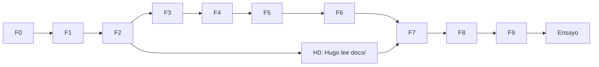
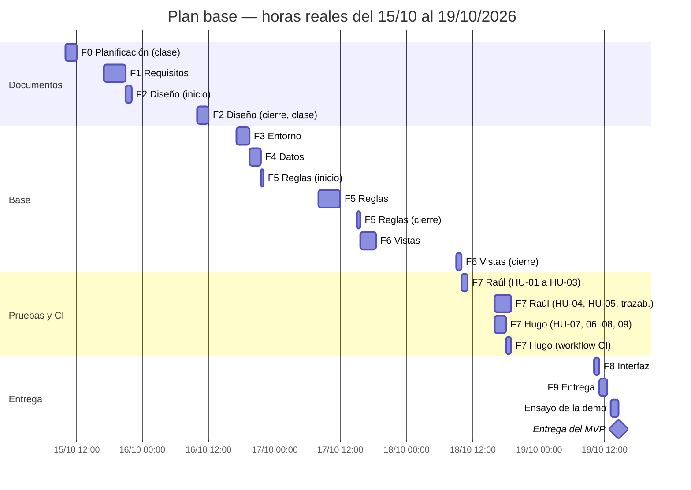

# Sesiones 8 y 9 — Plan del MVP (proyecto rehecho en cascada)

- Proyecto: Reserva de Salas de Estudio — UPB Santa Cruz (P02)
- Repositorio: [proyecto_reservacion_salas_final](https://github.com/raulandres24/proyecto_reservacion_salas_final)
- Integrantes que participan: Raúl Vaca (desde la fase 0) y Hugo Zúñiga (desde la fase 7)
- Docente y cliente: Ing. Sergio Barrientos
- Fecha del plan: 15/10/2026 · Entrega del MVP: lunes 19/10/2026, 14:30
- Issue: #1 · Milestone: F0 Planificación
- Última actualización: 18/10/2026, cambios C-12 a C-14 (secciones 10, 11 y 13); antes, 17/10/2026, al cerrar las fases 5 y 6

## 1. Punto de partida

- El repositorio anterior ([campus-challenge-equipo-01](https://github.com/raulandres24/campus-challenge-equipo-01)) queda solo como referencia y no se modifica, salvo la revisión de las sesiones 13–14.
- Decisión del 14/10/2026: tras la observación del docente sobre las 129 pruebas, Raúl decidió rehacer el proyecto en un repositorio nuevo y en cascada.
- Problemas del repositorio anterior que este plan busca evitar:
  - 129 pruebas (el docente observó que eran demasiadas), varias sin relación directa con un caso de uso;
  - reglas duplicadas en dos capas (el margen de 15 min definido en tres lugares);
  - `api_editar_reserva` (`reservas/views.py:436`), el endpoint de administración, guardaba los cambios sin pasar por las reglas: solo validaba que el fin fuera posterior al inicio y llamaba a `save()`. Se comprobó el 15/10/2026 leyendo el código, con asistencia de IA; Raúl lo confirmó;
  - documentos que contradecían el código;
  - una sola historia de usuario y un solo caso de uso para todo el sistema.
- Acuerdos con el docente (sesiones 4 y 6) que se conservan: `RES-RF-01` a `RES-RF-07`. Se reescriben en la fase 1 con su estado actual; por ejemplo, RF-04 tiene pendiente el caso de asistentes iguales a la capacidad.
- Propuesta del equipo, no confirmada por el docente: `RES-RC-01` (el rechazo muestra su causa concreta). Se mantiene como propuesta en la fase 1.
- Base de datos: MongoDB, aprobada por el docente el 07/10/2026 en lugar de MySQL/MariaDB.
- Datos del repositorio anterior que este plan cita, comprobados el 18/10/2026 contra el commit `4353d1d` (cambio C-12; las entrevistas y los enlaces están en [sesion-06-requisitos.md](sesion-06-requisitos.md), sección 9):
  - las 129 pruebas: `pytest` las recolecta (104 funciones `def test_` más las parametrizadas) y `docs/TRAZABILIDAD_PRUEBAS.md` también dice 129;
  - el margen de 15 min: tres definiciones (`reservas/models.py:106`, `proyecto/clases/horarios.py:13` y `proyecto/clases/sistema_reservas.py:30`) y un valor por defecto fijo (`proyecto/clases/reserva.py:221`);
  - `api_editar_reserva` (`reservas/views.py:436`): llama a `validar_rango_horario` y luego a `reserva.save()`; no pasa por `services.py`.

## 2. Alcance del MVP

**Actores:** estudiante de pregrado, docente y administrador.

- El **administrador** pone salas en mantenimiento, gestiona reservas ajenas y también reserva.
  - **Resuelto en la fase 1 por el cambio C-03:** el pendiente "ninguna historia cubre que el administrador reserve" se resolvió ampliando el actor de HU-05 a "personal: docente o administrador", sin historia nueva ni tests extra.
- El **docente** reserva para sí mismo, incluidas las salas A y E, sin límite de anticipación **[PROVISIONAL, P-13]**.
- El **estudiante de pregrado** no puede reservar las salas A y E **[PROVISIONAL, P-16]**.
- Las reglas vigentes y su estado (acuerdo, propuesta o provisional) están en [sesion-06-requisitos.md](sesion-06-requisitos.md). Si este plan y los requisitos difieren, mandan los requisitos.

| ID | Actor | Historia (resumen) | Por qué es necesaria |
|---|---|---|---|
| HU-01 | Persona del padrón sin cuenta | Registrarme con mi código y correo del padrón y elegir mi contraseña | Sin cuenta nadie reserva; es el recorrido FE → MW → Padrón → BD. |
| HU-02 | Usuario registrado | Iniciar y cerrar sesión con correo y contraseña | Hay que distinguir quién hace cada acción; es el recorrido FE → MW → BD. |
| HU-03 | Usuario con cuenta (C-05) | Consultar qué salas están libres en una fecha y un bloque | RES-02; es el primer paso del recorrido demostrable. |
| HU-04 | Estudiante de pregrado | Reservar una sala | Es el núcleo (RES-03, RES-04) y concentra la mayoría de las reglas. |
| HU-05 | Personal: docente o administrador (C-03) | Reservar una sala para mí, incluidas A y E | Es un actor real con reglas distintas: puede usar A y E y no tiene límite de anticipación. |
| HU-06 | Estudiante de pregrado | Ver mis reservas y cancelar una | RES-05; sin esto una sala no se libera. |
| HU-07 | Estudiante de pregrado | Modificar mi reserva antes de que empiece | RES-05, RF-03 y RF-06; es la operación de las sesiones 7, 12 y 13–14. |
| HU-08 | Administrador | Poner una sala en mantenimiento | RES-06; es una regla aprobada por el docente. |
| HU-09 | Administrador | Modificar o cancelar reservas ajenas con las mismas reglas | RES-05 para el operador; corrige la falla principal del repositorio anterior. |

En el repositorio anterior, `RES-HU-01` era "modificar una reserva". En este repositorio esa historia es **HU-07**.

**Fuera del MVP:** historial de correcciones y agenda por sala (RES-07, RES-08), estudiantes de posgrado y doctorado, salas G e I, envío real de email o WhatsApp (el encargo solo exige que el estado se pueda consultar en el sistema), reservas recurrentes y pagos.

## 3. Método: cascada con revisión

- Se trabaja una fase a la vez. Una fase se cierra con cuatro cosas: su entregable, un commit propio, la comprobación de que funciona y la aprobación explícita de Raúl.
- Dentro de una fase se trabaja un archivo a la vez.
- Los casos de prueba se **definen** en la fase 1 (criterios de aceptación) y se **programan** en la fase 7.
- Si una fase obliga a cambiar algo de una fase anterior, no se cambia en silencio: se registra en `docs/cambios.md` con motivo y fecha, y después se corrige.
- Al cerrar cada fase se actualizan las tablas 6 y 10 con la fecha real y el SHA del commit de cierre. Como un commit no puede contener su propio SHA, el SHA de una fase se anota en el commit de cierre de la fase siguiente.
- Cada commit cita su issue con `#n`.

## 4. Tareas

| Fase | Trabajo | Evidencia de terminación | Esfuerzo (h-p) | Duración (h) | Predecesora | Responsable | Sesión |
|---|---|---|---:|---:|---|---|---|
| F0 | Planificación | Este documento, Milestones e Issues creados | 2 | 2 | — | Raúl | 8–9 |
| F1 | Requisitos, historias y casos de uso | `sesion-06-requisitos.md` y `sesion-07-modelos.md` aprobados | 4 | 4 | F0 | Raúl | 6, 7 |
| F2 | Diseño | `sesion-13-14-diseno.md` y borrador de `sesion-12-arquitectura.md` aprobados | 3 | 3 | F1 | Raúl | 12, 13–14 |
| F3 | Entorno | MongoDB como replica set de un nodo; `runserver` arranca y se conecta | 2,5 | 2,5 | F2 | Raúl | — |
| F4 | Datos | Modelos, `padron.json` y salas cargadas; datos visibles con cualquier cliente de MongoDB | 2 | 2 | F3 | Raúl | 13–14 |
| F5 | Reglas | Una sola capa de reglas; cada historia probada a mano y explicada | 5 | 5 | F4 | Raúl | 6, 12 |
| F6 | Vistas | Cada operación responde bien con HTML simple | 4 | 4 | F5 | Raúl | 7, 12 |
| H0 | Lectura de `docs/` | Hugo puede explicar las historias y el diseño | 1 | 1 | F2 | Hugo | — |
| F7 | Pruebas, trazabilidad y CI | Todos los tests pasan en local; `trazabilidad.md` completa; primera ejecución en Actions | 7 | 4 | F6, H0 | Raúl y Hugo | 7, 10–11, 12 |
| F8 | Interfaz con Tailwind, mobile-first | Las pantallas se ven bien en celular y escritorio | 2 | 1 | F7 | Raúl y Hugo | — |
| F9 | Entrega | README, Gantt real contra los commits, revisión y CI en verde sobre el commit final | 3 | 1,5 | F8 | Raúl y Hugo | 12, 13–14 |
| E | Ensayo de la demo | Recorrido ensayado y cronometrado | 3 | 1,5 | F9 | Raúl y Hugo | 10–11 |

Esfuerzo total: **38,5 h-p**. Duración total: **31 h** de franjas de trabajo (incluye 0,5 h de margen).

**Reparto de la fase 7** (cambio del 15/10/2026, sección 11):

- Raúl escribe `conftest.py` y los tests de HU-01 a HU-05.
- Hugo escribe los tests de HU-07, HU-06, HU-08 y HU-09, **en ese orden de prioridad**. HU07-CA1, CA2 y CA4 son también las tres pruebas de la sesión 12.
- Si a las 18:00 del domingo faltan tests de Hugo, los que falten se registran en `trazabilidad.md` como "no implementado".
- La cantidad de tests se acordó en la fase 1: **26**, 15 de Raúl (HU-01 a HU-05) y 11 de Hugo (HU-06 a HU-09). La lista y lo que no se prueba están en [sesion-07-modelos.md](sesion-07-modelos.md), sección 6. Antes la estimación era de ~22 (sección 11).

**Por qué estas estimaciones:**

- F0, F1 y F2 son documentos; el tiempo se va en decidir y aprobar criterios.
- F3 supone que MongoDB ya está instalado. Si no lo está, suma ~1 h (riesgo 2).
- F5 y F6 incluyen el tiempo de explicar cada función antes de escribirla.
- No hay horas registradas de un trabajo parecido, así que las estimaciones se basan en el tamaño del trabajo, no en datos medidos.

## 5. Red, ruta crítica y tiempos

Horas medidas como horas de franja de trabajo desde `t = 0` (jueves 15/10, 10:00).

| Tarea | Duración | IT | FT | ITa | FTa | Holgura |
|---|---:|---:|---:|---:|---:|---:|
| F0 | 2 | 0 | 2 | 0 | 2 | 0 |
| F1 | 4 | 2 | 6 | 2 | 6 | 0 |
| F2 | 3 | 6 | 9 | 6 | 9 | 0 |
| F3 | 2,5 | 9 | 11,5 | 9 | 11,5 | 0 |
| F4 | 2 | 11,5 | 13,5 | 11,5 | 13,5 | 0 |
| F5 | 5 | 13,5 | 18,5 | 13,5 | 18,5 | 0 |
| F6 | 4 | 18,5 | 22,5 | 18,5 | 22,5 | 0 |
| H0 | 1 | 9 | 10 | 21,5 | 22,5 | 12,5 |
| F7 | 4 | 22,5 | 26,5 | 22,5 | 26,5 | 0 |
| F8 | 1 | 26,5 | 27,5 | 26,5 | 27,5 | 0 |
| F9 | 1,5 | 27,5 | 29 | 27,5 | 29 | 0 |
| Margen | 0,5 | 29 | 29,5 | — | — | — |
| E | 1,5 | 29,5 | 31 | 29,5 | 31 | 0 |

- **Ruta crítica: F0 → F1 → … → F9 → E**, de 30,5 h. En una cascada estricta no hay ninguna fase en paralelo, así que **toda fase es crítica**. Un retraso en cualquiera de ellas mueve la entrega.
- Solo H0 tiene holgura. Raúl y Hugo trabajan en paralelo únicamente dentro de F7, F8 y F9.

## 6. Horario real y Gantt base

| Día | Franja | Trabajo | Tipo de hora |
|---|---|---|---|
| Jue 15 | 2 h dentro de 10:00–16:30 | **F0** → commit | Clase (colchón) |
| | 17:00–21:00 | **F1** → commit | Segura |
| | 21:00–22:00 | **F2** (inicio) | Segura |
| Vie 16 | 2 h dentro de 10:00–16:30 | **F2** (cierre) → commit | Clase (colchón) |
| | 17:00–19:30 | **F3** → commit | Segura |
| | 19:30–21:30 | **F4** → commit | Segura |
| | 21:30–22:00 | **F5** (inicio) | Segura |
| Sáb 17 | 08:00–12:00 | **F5**, un commit por historia | Segura |
| | 15:00–15:30 | **F5** (cierre) | Segura |
| | 15:30–18:30 | **F6** | Segura |
| Sáb 17 o Dom 18 | antes de las 16:00 | **H0** (Hugo lee `docs/`) | Hugo |
| Dom 18 | 09:00–10:00 | **F6** (cierre) → commit | Segura |
| | 10:00–11:00 | **F7**: Raúl, `conftest.py` y tests de HU-01 a HU-03 | Segura |
| | 16:00–17:00 | **F7**: Raúl, tests de HU-04 y HU-05 | Segura |
| | 16:00–18:00 | **F7**: Hugo, tests de HU-07, HU-06, HU-08 y HU-09 | Hugo |
| | 17:00–18:00 | **F7**: Raúl ejecuta la suite completa, escribe `trazabilidad.md` y revisa los tests de Hugo | Segura |
| | 18:00–19:00 | **F7**: Hugo escribe el workflow de CI, hace push y lanza la primera ejecución en Actions; Raúl registra la URL y el SHA → cierre de F7 | Segura |
| Lun 19 | 10:00–11:00 | **F8**: Raúl hace `base.html`, registro, login, consultar y reservar; Hugo hace mis reservas, modificar y las dos pantallas de administración → commit | Segura |
| | 11:00–12:30 | **F9**: Raúl hace el README, el Gantt real y la revisión; Hugo solo corrige el CI si falla → commit final | Segura |
| | 12:30–13:00 | Margen | — |
| | 13:00–14:30 | **Ensayo de la demo** | Segura |
| | 14:30 | **Entrega** | — |

## 7. Disponibilidad y capacidad

| Persona | Horas seguras | Colchón | Observación |
|---|---|---|---|
| Raúl | Jue 17:00–22:00 · Vie 17:00–22:00 · Sáb 08:00–12:00 y 15:00–18:30 · Dom 09:00–11:00 y 16:00–19:00 · Lun 10:00–14:30. **Total: 27 h** (25,5 h de trabajo y 1,5 h de ensayo). | Clases del jueves y del viernes, de 10:00 a 16:30. No son horas seguras; se usan 2 h cada día para F0 y F2. | — |
| Hugo | Confirmado el 15/10/2026: Dom 16:00–19:00 · Lun 10:00–12:30, más 1 h de lectura (H0). | — | Entra cuando la base está aprobada, para no cambiar lo ya hecho. |

**Conflicto de capacidad:**

- Raúl necesita **29 h** de trabajo y tiene **25,5 h** seguras.
- El plan cierra gracias a **4 h de colchón** en clase (F0 el jueves y parte de F2 el viernes) y deja **0,5 h de margen**.
- Si se pierde el colchón o falta Hugo, se aplican los recortes de la sección 9.

## 8. Riesgos

| # | Riesgo | Probabilidad y razón | Consecuencia | Respuesta antes del problema | Señal y contingencia | Responsable |
|---|---|---|---|---|---|---|
| 1 | No se puede avanzar F0 o F2 en clase | Media: las clases no son horas seguras | Faltan entre 2 y 4 h | Llevar a clase el contenido ya preparado | Jue 17:00 sin F0 cerrada → **R1**. Vie 17:00 sin F2 cerrada → **R2** | Raúl |
| 2 | MongoDB no está instalado, o el replica set no arranca a la primera | Media: aún no se comprobó la instalación local | F3 crece ~1 h | Comprobar la instalación al empezar F3, antes de instalar Django | F3 sin cerrar el viernes a las 19:30 → **R2** | Raúl |
| 3 | Hugo no está disponible el domingo o el lunes | Baja: Hugo confirmó el 15/10/2026. El riesgo se mantiene por si algo cambia. | F7 y F8 recaen en Raúl (+2 h) | Disponibilidad confirmada el 15/10/2026; **R3 no se activa** | Hugo avisa que no puede, o no se presenta el domingo a las 16:00 → **R3** | Raúl |
| 4 | Los tests revelan fallos en las reglas | Alta: es la primera vez que se prueban en conjunto | Hay que corregir código de F5 | Probar a mano cada regla al cerrar F5 | Test en rojo en F7 → **R4** | Raúl |
| 5 | El docente responde distinto de un valor provisional (sección 12) | Media: ya hubo respuestas distintas entre las sesiones 4 y 6 | Cambian un criterio, una regla y su test | Cada regla está en un solo lugar (`reglas.py`) | Respuesta distinta → se registra en `docs/cambios.md` y se corrige | Raúl |
| 6 | Solo Raúl conoce el backend | Alta: Hugo entra en F7 | Si Raúl falla, el plan se detiene | Documentos de F1 y F2 completos; lectura H0 de Hugo | — | Raúl |

## 9. Recortes aprobados (en este orden)

| Recorte | Se activa cuando | Qué se recorta | Ahorro aproximado |
|---|---|---|---|
| R1 | Jue 17:00 sin F0 cerrada | g) solo **cancelar** reservas ajenas, sin modificarlas | 1 h |
| R2 | Vie 17:00 sin F2 cerrada, o F3 crece | b) la consulta se reduce a una lista simple de salas libres para una fecha | 0,5–1 h |
| R3 | Hugo no disponible | Tailwind solo en las 5 pantallas principales (registro, login, reservar, mis reservas, modificar); administración queda en HTML simple | 1 h |
| R4 | Los tests revelan fallos en las reglas | El tiempo para arreglarlos sale de **F8 (interfaz)**, nunca de otra fase | Lo que tome el arreglo |

Las vistas de F6 ya funcionan con HTML simple. Por eso lo que no alcance en F8 afecta solo al aspecto, no a las operaciones. Si se activan R1, R2 y R3 a la vez y aun así no alcanza, se avisa el sábado y se decide juntos qué más sale.

## 10. Entregable, hito y estado real

**Entregable:** un commit identificado en `main` con el MVP (historias HU-01 a HU-09), sus tests, la trazabilidad, el CI y las instrucciones de instalación.

**Hito verificable (lunes 19/10, 13:00):** sobre ese mismo commit:

1. se completa el recorrido de la demo: registro, login, consultar, reservar, una solicitud en conflicto rechazada con su causa, una modificación válida, una modificación inválida que conserva la reserva, cancelar, y el administrador poniendo una sala en mantenimiento;
2. los tests pasan en local y en GitHub Actions;
3. `trazabilidad.md` relaciona cada test con su historia, criterio y caso de uso;
4. el README permite instalar y ejecutar el proyecto desde cero.

**Estado real:**

| Fase | Estado | Fecha y hora real de cierre | Commits | Horas reales |
|---|---|---|---|---|
| F0 | Terminada, en clase (colchón), como estaba previsto | 15/10/2026, 10:52 | `65188dc` (Closes #1); `9465262` renombra el archivo, sin cita de issue | 2 Hrs |
| F1 | Terminada, con la aprobación de Raúl (15/10/2026) | 15/10/2026, 20:13 (último entregable) | `43d2cb9`, `660af2a` (Closes #2), C-04 (de `7800f85` a `8f2f609`, ver nota) y `039cb9b` (Closes #3). **Cierre en el plan: `30b824b`**; horas corregidas en `a8549be` | 4 Hrs |
| F2 | Terminada con los commits de cierre de la fase 2, con la aprobación de Raúl | 16/10/2026, 12:02 | `3f599d6` (C-06 y C-07, Refs #4), `7cbd10a` (diseño, Closes #4), `b1c0085` (borrador de la sesión 12, Refs #5) y `dea61ee` (cierre en el plan); hora y horas corregidas en `8ab4ee6` y `f3d2983` | 3 Hrs |
| F3 | Terminada, con la aprobación de Raúl | 16/10/2026, 18:46 | `9c422fe` (Closes #6) y `b447d06` (Refs #6). Cierre en el plan: `28a4f2c`; diseño: `0789faf`; formato del plan corregido en `9c2b128` y `cd8ae45` (todos Refs #6) | 2 Hrs (estimación) |
| F4 | Terminada, con la aprobación de Raúl | 17/10/2026, 12:11 | `79d5f0c`, `b7a3f41`, `55b79a9`, `1bf3119`, `b10e601` y `b1f3c6f` (Refs #7). Corrección del padrón (C-09): `5cf384c` (Refs #7); cierre en los documentos: `9f85502` (Closes #7) | 2,2 Hrs |
| F5 | Terminada, con la aprobación de Raúl | 17/10/2026, 15:21 | 16 commits, de `19774da` a `a1776d2` (Refs #8; el último, Closes #8). Limpieza de imports posterior: `c309c39` (Refs #10). El cierre en los documentos se anota al cerrar F7 | 2,4 Hrs (2 h 25 min) |
| F6 | Terminada, con la aprobación de Raúl | 17/10/2026, 17:05 (cierre del último issue) | `62e3b95`, `ba9020f`, `7cd3aca` y `988dea1`, ligados al #9 por error (ver nota). Dos desviaciones del diseño corregidas al cerrar: `1d892c9` (Refs #13) y `67d5462` (Refs #16) | 1,75 Hrs (1 h 45 min) |
| F7 a F9 | No iniciada | — | — | — |

**Notas del estado real:**

- **Cambios del 18/10/2026, después de cerrar F4 y F6:** C-12 (entrevistas y datos del repositorio anterior, como anexo de los requisitos), C-13 (Hugo como tercer administrador: el padrón pasa a 24 entradas) y C-14 (glosario de siglas en `docs/glosario.md`). No cambian ninguna fase, fecha ni tarea. Ver [cambios.md](cambios.md).
- **Señal de R1:** F0 se cerró a las 10:52, antes de las 17:00. **R1 no se activa.**
- **Señal de R2:** F2 se cerró el viernes 16/10 a las 12:02, antes de las 17:00. **R2 no se activa.**
- **Señal del riesgo 2 (F3):** F3 se cerró el viernes 16/10 a las 18:46, antes de las 19:30. **R2 no se activa.**
- **F3 empezó antes de lo previsto:** se trabajó en dos tramos, de 14:53 a 15:24 y de 17:12 a 18:46. El plan la tenía de 17:00 a 19:30.
- **F3 no ejecutó `migrate`:** con el usuario propio (D-05), `AUTH_USER_MODEL` se declara en F4 antes de la primera migración.
- **F4 terminó después de su franja:** el plan la tenía el viernes de 19:30 a 21:30. Se trabajó el viernes de 20:43 a 22:01 y el sábado de 10:25 a 11:11 y de 12:02 a 12:11 (pausa de 11:11 a 12:02). La franja de F5 del sábado de 08:00 a 12:00 no se usó.
- **F5 y F6 cerraron antes de lo planeado:** el plan les daba 5 h y 4 h, hasta el domingo a las 10:00. Se hicieron el sábado en 4,2 h (4 h 10 min): F5 de 12:25 a 15:21 (menos 30 min de comida) y F6 de 15:21 a 17:05. La sesión de estudio de Raúl sobre el código, desde las 17:05, no se cuenta en ninguna fase.
- **F5 se probó a mano**, con scripts locales que no se versionan (`prueba_*.py`). Una falla simulada dentro del mantenimiento dejó todo intacto (D-04). Los tests automáticos son de F7.
- **F6 se probó en el navegador** con una cuenta de administrador y otra de estudiante. Queda para F8 (#24) el enlace "Modificar" del administrador en reservas ajenas: la regla ya lo permite, pero hoy solo se llega escribiendo la URL.
- **Dos desviaciones del diseño, encontradas al cerrar F6** al comparar el código con el diseño, y corregidas en el código el 17/10 (probadas en el navegador):
  - el mantenimiento aceptaba en silencio un bloque ya registrado, en lugar de rechazar todo el registro (diseño, sección 2.1, [DECISIÓN F2]). Corregido en `1d892c9`: registrar la sala C con B2 y B3, con B3 ya en mantenimiento, da "la sala ya está en mantenimiento en ese bloque", B2 no queda registrado y la reserva de C en B2 sigue Confirmada;
  - "Mis reservas" no mostraba el motivo de cancelación (diseño, sección 4.3). Corregido en `67d5462`: aparecen "Por el administrador", "No la mantuvo" y "Por mantenimiento", y el motivo queda vacío en las Confirmadas.

  No hay cambio en `cambios.md`: el diseño no cambió; el que se desviaba era el código.
- **Issues de F6:** los commits `62e3b95`, `ba9020f`, `7cd3aca` y `988dea1` citan el #9 por error; el #9 es HU-03, de F5, y su contenido sí estaba hecho. No se reescribió el historial. Los issues #15, #16 y #17 se cerraron a mano, con comentarios que citan los commits. Siguen abiertos el #5 (hasta escribir las secciones 6 y 7 de la sesión 12, en F7), el #18, el #19 y del #21 al #26.
- **F4 confirmó los puntos [A CONFIRMAR EN F4] del diseño** (secciones 2.4 y 3.4) y encontró que, con este conector, `django.db.transaction.atomic()` no hace nada: F5 usa `django_mongodb_backend.transaction.atomic()` (D-04).
- **F2 empezó el jueves a las 21:00** con las secciones 1 a 3 del diseño y se completó en la clase del viernes (colchón), como estaba previsto.
- **F1 empezó antes de lo previsto:** arrancó en clase después de cerrar F0, usando el colchón, y terminó a las 20:13. El plan la tenía de 17:00 a 21:00.
- **El cambio C-04 se subió en 7 commits:**
  - `7800f85` creó por error `docs/cambios`, sin extensión;
  - `0a485c2`, `1f96018` y `44fa48b` borraron `docs/cambios`, `docs/cambios.md` y `docs/sesion-06-requisitos.md`;
  - `0e55c2a` y `12d46ce` volvieron a subir los archivos (el primero como `cambio.md`);
  - `8f2f609` lo renombró a `cambios.md`.

  Entre `44fa48b` y `12d46ce` el repositorio estuvo sin los requisitos. El contenido final coincide con el aprobado. Los commits de borrado y de renombre (`0a485c2`, `1f96018`, `44fa48b`, `8f2f609` y `9465262`) no citan un issue, aunque la regla dice que todos deben hacerlo. Desde la fase 3 se trabaja con git en local, lo que evita los commits automáticos de la web de GitHub.

## 11. Cambios al plan

| Fecha | Cambio | Motivo | Aprobó |
|---|---|---|---|
| 15/10/2026 | El workflow de CI lo escribe Hugo el domingo, al cerrar F7, y su primera ejecución en Actions es ese mismo día. El lunes solo se corrige. | Tener evidencia de CI antes del día de entrega. | Raúl |
| 15/10/2026 | F7 se reequilibra: Hugo escribe tests de 16:00 a 18:00 (antes era 1 h), y F8 baja a 1 h por persona el lunes. | Una hora era poco para ~10 tests. | Raúl |
| 15/10/2026 | Hugo confirma su disponibilidad (Dom 16:00–19:00, Lun 10:00–12:30 y 1 h de lectura de `docs/`). Se quita "por confirmar" del plan y R3 no se activa. | Se cumplió la condición del riesgo 3. | Raúl |
| 15/10/2026 | Se agrega el recorte R4: los arreglos que revelen los tests salen de F8. | Proteger las fases funcionales. | Raúl |
| 15/10/2026 | La estimación de tests pasa de ~22 (unos 12 de Raúl y 10 de Hugo) a **26 (15 de Raúl y 11 de Hugo)**. Las franjas de F7 no cambian. | La lista de criterios aprobada en F1 cubre las reglas del MVP; lo que no se prueba se declara en la trazabilidad. | Raúl |
| 15/10/2026 | **Numeración real de los issues:** del #1 al #19 coinciden con la lista de la fase 0. El **#20** era un duplicado y se borró. Desde ahí todo se corre uno: #21 workflow de CI, #22 trazabilidad, #23 interfaz (Raúl), #24 interfaz (Hugo), **#25 README**, Gantt real y revisión final, y **#26 preguntas abiertas al docente**. | Se creó un issue duplicado entre el #19 y el #20. | Raúl |
| 15/10/2026 | El pendiente del administrador que reserva (sección 2) queda resuelto por C-03. HU-03 cambia de actor a "usuario con cuenta" (C-05). | Decisiones de la fase 1, registradas en `cambios.md`. | Raúl |
| 15/10/2026 | La sección 12 deja de copiar las preguntas al docente y remite a los requisitos. | Evitar dos listas que se desactualicen, como pasó en el repositorio anterior. | Raúl |
| 16/10/2026 | El criterio de cierre de F4 dice "datos visibles con cualquier cliente de MongoDB" en lugar de "Compass". | Los documentos del repositorio no nombran una herramienta concreta para mirar los datos. | Raúl |
| 17/10/2026 | F7 se reparte por tipo de prueba, sin cambiar las cantidades (15 de Raúl y 11 de Hugo). Raúl escribe `conftest.py` y sus tests de HU-04 y HU-05 el domingo de 11:00 a 16:00; Hugo empieza a las 16:00 con esa base lista y toma los tests de reglas puras, que no necesitan base de datos. La tabla de franjas (sección 6) no se rehace. | Aprovechar el adelanto de F5 y F6, y que Hugo empiece por pruebas que no dependen de la base. | Raúl |
| 18/10/2026 | Se registran los cambios C-12 (entrevistas y datos del repositorio anterior, como anexo de los requisitos), C-13 (Hugo Zúñiga como tercer administrador del padrón, código 10003; el padrón pasa a 24 entradas) y C-14 (glosario de siglas, `docs/glosario.md`, con autor, revisor y justificación). No cambia ninguna fase, fecha, tarea ni responsable. | Poder leer las fuentes sin salir del repositorio (C-12). Hugo necesita su propia cuenta de administrador para probar las pantallas de administración y escribir los tests de HU-08 y HU-09, en F7 y F8 (C-13). Un solo glosario para las siglas que Hugo lee en H0 (C-14). | Pedido de Hugo (issue #28) |

## 12. Dudas abiertas con el docente

La lista vigente, con 17 preguntas (P-01 a P-17) y sus valores provisionales, está en [sesion-06-requisitos.md](sesion-06-requisitos.md), sección 6, y se sigue en el issue **#26**. Este plan ya no la copia, para no tener dos listas que se contradigan.

Si no hay respuesta antes del viernes 16/10, rigen los valores provisionales. Cada respuesta del docente que cambie algo se registra en [cambios.md](cambios.md).

## 13. Participación y asistencia utilizada

- **Raúl Vaca:** tras la observación del docente sobre las 129 pruebas, decidió rehacer el proyecto (14/10/2026); definió el alcance, los roles, las franjas horarias, los cambios al plan y los recortes, y aprobó las historias y la estructura.
- **Hugo Zúñiga:** sin aporte en F0; confirmó su disponibilidad el 15/10/2026 y se incorpora en F7.
- **Fase 1:** Raúl respondió las preguntas de la fase, aprobó los requisitos, los 26 criterios y los cambios C-01 a C-05, y subió los documentos. Hugo no tuvo aporte en esta fase.
- **Fase 2:** Raúl respondió las preguntas del diseño, aprobó las decisiones D-01 a D-10 y revisó los documentos; Claude (Anthropic) las propuso y redactó. Hugo no tuvo aporte en esta fase.
- **Fase 3:** Raúl montó el entorno en su computadora, ejecutó cada comando, revisó los archivos y subió los commits; Claude (Anthropic) lo guió comando por comando, propuso la configuración y revisó el resultado. Hugo no tuvo aporte en esta fase.
- **Fase 4:** Claude (Anthropic) propuso el código de la fase y revisó los commits contra el diseño. Raúl lo puso en su proyecto, lo probó, decidió los cambios C-08 y C-09 y subió los commits. Hugo no tuvo aporte en esta fase.
- **Fases 5 y 6:** Claude (Anthropic) propuso el código de las reglas, los servicios, las vistas y las plantillas, función por función, y revisó el código contra el diseño, donde encontró las diferencias de C-10 y las dos desviaciones corregidas al cerrar F6. Raúl lo puso en su proyecto, lo probó a mano y en el navegador, aprobó C-10 y subió los commits; desde las 17:05 lo estudia para poder explicarlo. Hugo no tuvo aporte en estas fases.
- **Asistencia de IA:** se usó Claude (Anthropic) para leer las guías de las sesiones y el repositorio anterior, para proponer la lista de historias, las estimaciones, el cronograma y la estructura de carpetas, y, desde la fase 4, para proponer el código. Raúl revisó, cambió y aprobó el plan.
- **Cambios C-12, C-13 y C-14 (18/10/2026):** Hugo Zúñiga pidió sumar los datos del repositorio anterior, agregarse al padrón como administrador (código 10003) y crear el glosario de siglas (issue #28, H0). Claude (Anthropic) los aplicó en el padrón, los requisitos, el diseño, la sesión 12, el plan y el registro de cambios, y comprobó los datos citados contra el commit `4353d1d` del repositorio anterior.
