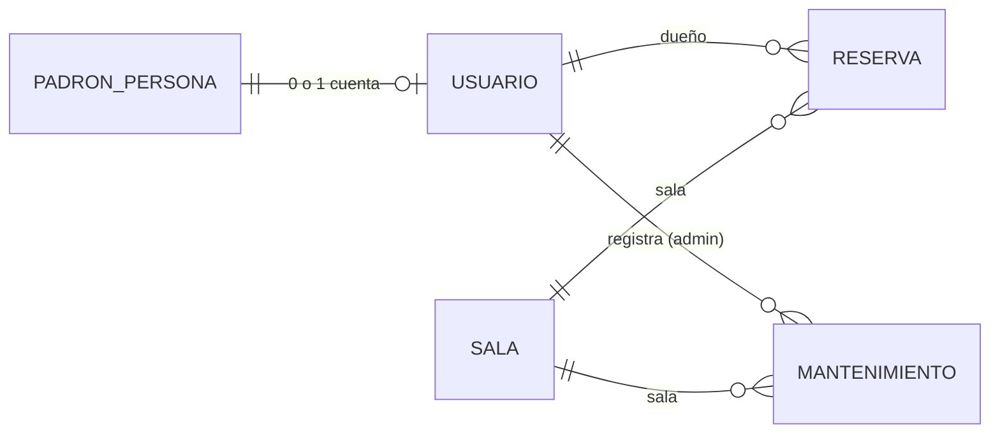
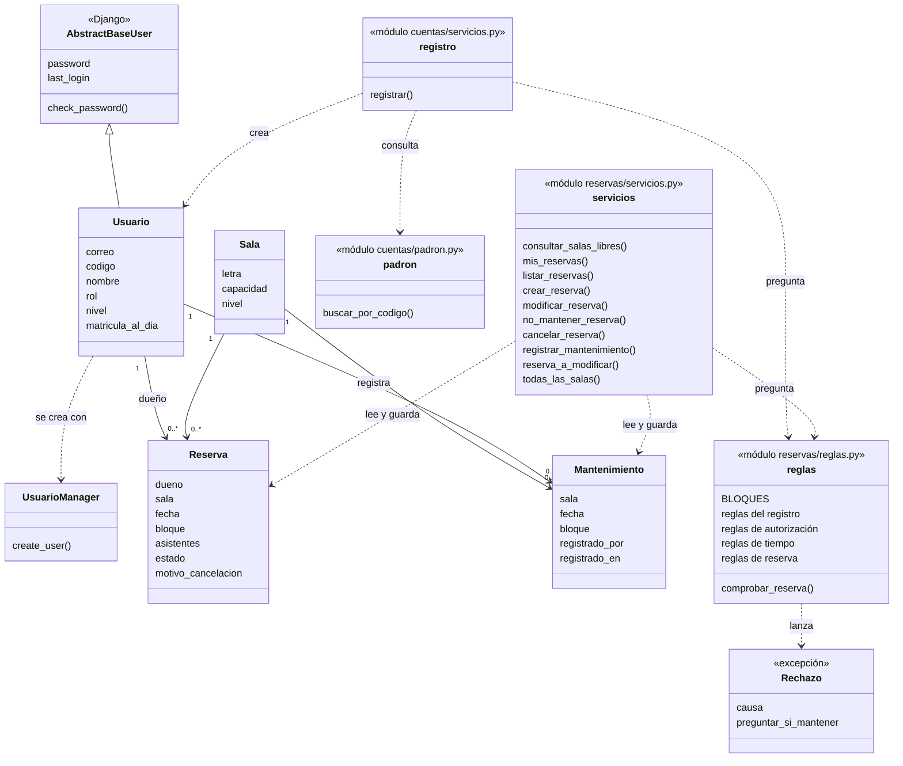
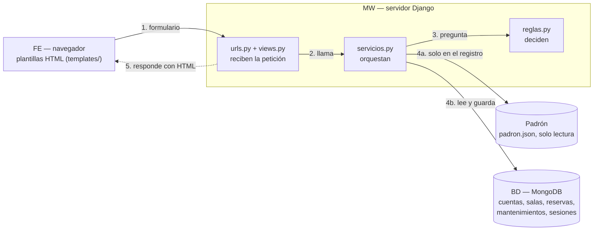
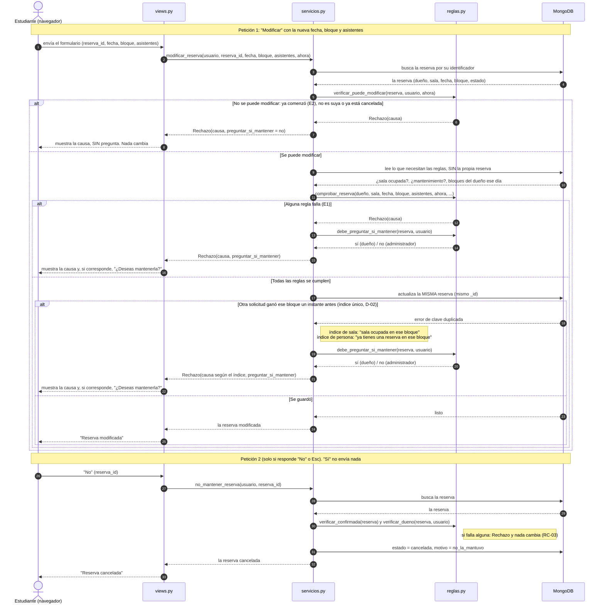

# Sesiones 13–14 — Diseño del MVP

- Proyecto: Reserva de Salas de Estudio — UPB Santa Cruz (P02)
- Integrantes que participan: Raúl Vaca (Hugo Zúñiga se incorpora en la fase 7)
- Fecha: 15–16/10/2026 · Fase 2 · Issue #4 · Milestone F2 Diseño
- Fuentes: [Requisitos](sesion-06-requisitos.md) · [Historias y casos de uso](sesion-07-modelos.md) · [Cambios](cambios.md) · [Plan](sesion-08-09-plan.md)
- Actualizado: 27/10/2026 · confirmación de la contraseña en el registro: D-10 y secciones 3.2, 4.3 y 4.4 (C-15)

## 0. Cómo leer este documento

- Las reglas de negocio y su estado (**[ACUERDO]**, **[PROPUESTA]**, **[PROVISIONAL]**) están en los requisitos. Este documento no crea reglas nuevas: decide **cómo** se cumplen.
- **[DECISIÓN F2]**: decisión de diseño de Raúl tomada en la fase 2 (15/10/2026).
- **[A CONFIRMAR EN F3]** o **[A CONFIRMAR EN F4]**: detalle técnico de django-mongodb-backend que se comprueba con la versión instalada (Django 5.2). Si no funciona como se espera, se registra un cambio en `cambios.md` antes de corregir el diseño.

## 1. Decisiones de diseño

| ID | Decisión | Por qué | Requisito o caso de uso |
|---|---|---|---|
| D-01 | **La matrícula al día, el rol y el nivel se copian del padrón a la cuenta al registrarse.** Reservar es FE → MW → BD y no vuelve a consultar el padrón. | Mantiene el recorrido que dibujó el docente: el padrón solo se consulta en el registro. | RF-05, RF-13; CU-01 |
| D-02 | **Índices únicos parciales**, que solo cuentan las reservas Confirmadas: (1) sala + fecha + bloque y (2) dueño + fecha + bloque. | Una transacción sola **no** impide que dos solicitudes simultáneas inserten dos documentos distintos. El índice hace que la base de datos rechace la segunda. | RF-01, RF-07 (índice 1); RF-02 (índice 2) |
| D-03 | **`servicios.py` captura el error de clave duplicada** y lo traduce al mismo rechazo que daría la regla: "sala ocupada en ese bloque" (índice 1) o "ya tienes una reserva en ese bloque" (índice 2). | El usuario recibe la misma causa haya o no un empate al mismo instante (RC-01). La regla sigue viviendo en `reglas.py`; el índice es la última barrera. | RF-01, RF-02, RF-07, RC-01 |
| D-04 | **El mantenimiento se registra en una transacción**: el período y la cancelación de las reservas afectadas ocurren juntos o no ocurre nada. Las transacciones necesitan MongoDB como *replica set* de un nodo (plan, fase 3). Se abren con `django_mongodb_backend.transaction.atomic()`: con este conector, `django.db.transaction.atomic()` no hace nada (confirmado en F4). | Un rechazo o un error no puede dejar la operación a medias. | RF-12, RC-03; CU-08 |
| D-05 | **Usuario propio `cuentas.Usuario`, sobre `AbstractBaseUser`**: un documento por persona, login por correo. `rol` es la única fuente de permisos. Correo y código son únicos. La cuenta **no guarda `is_active`**. Las cuentas solo se crean con el registro. | Detalle en la sección 3. | RF-13, RF-14; CU-01, CU-02 |
| D-06 | **Sin el panel `/admin/` de Django.** Todo lo del rol administrador pasa por nuestras vistas y servicios. | El panel guarda directamente en la base, sin reglas: es la falla del repositorio anterior. | HU-08, HU-09 |
| D-07 | **Comando `cargar_salas`**, que carga las 8 salas. Se puede correr varias veces sin duplicar: busca cada sala por su letra y, si existe, la actualiza. **[DECISIÓN F2, 15/10/2026]** | Se corre en la fase 4 y antes de los tests; correrlo dos veces no debe crear salas repetidas. | Datos de la sección 0 de los requisitos |
| D-08 | **El padrón es un archivo JSON de solo lectura** (`padron/padron.json`). Solo lo lee `cuentas/padron.py` y **no se carga en la base de datos**. | Es la "base de datos estática" del dibujo del docente; el sistema nunca la modifica. | RF-13 |
| D-09 | **Diagrama de secuencia de CU-07 (modificar)**, con el rechazo, la respuesta "Sí/No" a "¿Deseas mantenerla?" como petición aparte y el índice único como última barrera. | Es la misma operación del diagrama de actividad (sesión 7), de la sesión 12 y de sus tres pruebas. | CU-07 (sección 6, viernes) |
| D-10 | **Las comprobaciones del registro (los cinco rechazos de RF-13, incluida la confirmación de la contraseña (C-15), y las reglas de contraseña de Django) están en `reservas/reglas.py`**, el único archivo de reglas, y no leen ni escriben en la base. `cuentas/servicios.py` solo orquesta: lee el padrón, le pregunta a `reglas` y crea la cuenta. **[DECISIÓN F2]** | Mantiene un solo lugar para todas las reglas de negocio. **Costo:** `reglas.py` incluye también las comprobaciones del registro y `cuentas/servicios.py` lo importa; `verificar_contrasena` usa las reglas de contraseña de Django; no hay importación circular porque `reglas.py` no toca modelos. | RF-13; CU-01 |

### Limitaciones que resultan del diseño

| Limitación | De qué decisión sale | Relación con el docente |
|---|---|---|
| Si el padrón cambiara después del registro (por ejemplo, alguien deja de tener la matrícula al día), la cuenta no se entera. | D-01 | Pregunta abierta **P-17** (cambio C-06). En el MVP el padrón es estático y de solo lectura, así que no ocurre. |
| **En el MVP no hay forma de bloquear una cuenta**: como la cuenta no guarda `is_active`, Django la trata siempre como activa. | D-05 | Ligada a **P-17**: si el docente pidiera reflejar cambios del padrón, habría que agregar el campo con una migración. |
| Dos pedidos **de la misma persona en el mismo instante** para bloques contiguos (por ejemplo, B2 y B3 en salas distintas) podrían aceptarse los dos, porque RF-08 no se puede expresar como índice. | D-02 | Es una limitación técnica de RF-08. Se agrega a "Lo que no se prueba" (cambio C-07). |
| Una reserva creada **en el mismo instante** en que se registra un mantenimiento de esa sala y ese bloque podría quedar Confirmada. La razón es la misma que en RF-07: la transacción del mantenimiento y la reserva escriben documentos distintos, así que no chocan, y ningún índice une las reservas con los mantenimientos. | D-02, D-04 | Es una limitación técnica de RF-12. Se agrega a "Lo que no se prueba" (cambio C-07). |

## 2. Datos

### 2.1 Colecciones

Cada modelo de Django se guarda como una colección de MongoDB. El nombre lo pone Django (`app_modelo`). Cada documento tiene un `_id` de tipo ObjectId.

**`cuentas_usuario`** — una cuenta por persona registrada (D-05)

| Campo | Tipo | Regla | De dónde sale |
|---|---|---|---|
| `_id` | ObjectId | Identificador | MongoDB |
| `correo` | texto | **Único**. Es el dato con el que se entra. | Padrón |
| `codigo` | texto de hasta 6 dígitos (C-08) | **Único** | Padrón |
| `nombre` | texto | — | Padrón |
| `rol` | `estudiante` · `docente` · `administrador` | Única fuente de permisos | Padrón |
| `nivel` | `pregrado` · `posgrado` · vacío | Solo para estudiantes; vacío para el personal | Padrón |
| `matricula_al_dia` | sí/no | RF-05; solo cuenta para estudiantes | Padrón, copiado al registrarse (D-01) |
| `password` | texto | **Cifrada por Django**; nunca se guarda la contraseña tal cual | La elige la persona |
| `last_login` | fecha y hora | La actualiza Django | Django |

**`reservas_sala`** — las 8 salas, que carga `cargar_salas` (D-07)

| Campo | Tipo | Regla |
|---|---|---|
| `_id` | ObjectId | Identificador |
| `letra` | A, B, C, D, E, F, H o J | **Única**. Es la que usa `cargar_salas` para no duplicar. |
| `capacidad` | entero | **[PROVISIONAL, P-11]**: A 6, B 4, C 6, D 8, E 10, F 6, H 12, J 4 |
| `nivel` | `pregrado` · `posgrado` | A y E son de posgrado (RF-11) |

**`reservas_reserva`** — cada reserva, confirmada o cancelada

| Campo | Tipo | Regla |
|---|---|---|
| `_id` | ObjectId | Identificador. Al modificar, **es el mismo** (CU-07). |
| `dueno` | referencia a `cuentas_usuario` | Quién es el dueño de la reserva (C-04) |
| `sala` | referencia a `reservas_sala` | No cambia al modificar **[PROVISIONAL, P-09]** |
| `fecha` | fecha | Lunes a viernes (RF-09) |
| `bloque` | entero de 1 a 6 | B1 a B6. Los horarios están en una sola constante del código, no en la base (sección 2.3). |
| `asistentes` | entero ≥ 1 | No supera la capacidad (RF-04) |
| `estado` | `confirmada` · `cancelada` | Sección 5 de `sesion-07-modelos.md` |
| `motivo_cancelacion` | vacío · `por_el_dueno` · `no_la_mantuvo` · `por_el_administrador` · `por_mantenimiento` | Vacío mientras está confirmada |

**`reservas_mantenimiento`** — un documento por sala, fecha y bloque en mantenimiento

| Campo | Tipo | Regla |
|---|---|---|
| `_id` | ObjectId | Identificador |
| `sala` | referencia a `reservas_sala` | — |
| `fecha` | fecha | — |
| `bloque` | entero de 1 a 6 | Solo bloques que todavía no empezaron (RF-12) |
| `registrado_por` | referencia a `cuentas_usuario` | Un administrador |
| `registrado_en` | fecha y hora | — |

Si el administrador marca B2 y B3, se crean **dos documentos**, uno por bloque **[DECISIÓN F2]**. Así, preguntar "¿la sala C está en mantenimiento el 22/10 en B3?" es buscar un solo documento, y un índice único (sala + fecha + bloque) impide registrar el mismo bloque dos veces.

**Si uno de los bloques pedidos ya está en mantenimiento** **[DECISIÓN F2]**: se rechaza **todo** el registro con "la sala ya está en mantenimiento en ese bloque". No se registra ningún bloque y no se cancela ninguna reserva. Así se mantiene el "todo o nada" de la transacción (D-04, RC-03): el error de clave duplicada deshace la transacción completa.

**`django_session`** — la crea `django.contrib.sessions` para guardar las sesiones iniciadas (RF-14). No la tocamos.

**Fuera de la base de datos:**
- El padrón (`padron/padron.json`, D-08), con 24 entradas (cambios C-09 y C-13) y los campos: `codigo`, `nombre`, `correo`, `rol`, `nivel`, `matricula_al_dia` y `activo`. El campo `activo` del padrón **solo se comprueba al registrarse** (RF-13) y no se copia a la cuenta.
- Los horarios de los bloques (sección 2.3).

### 2.2 Relaciones y multiplicidades

| Relación | Multiplicidad | Cómo se guarda |
|---|---|---|
| Persona del padrón → cuenta | 1 a 0..1: una persona tiene como máximo una cuenta | El código es único en la cuenta (RF-13, rechazo "ya tienes una cuenta") |
| Cuenta → reservas | 1 a 0..* | Campo `dueno` en la reserva |
| Sala → reservas | 1 a 0..* | Campo `sala` en la reserva |
| Sala → mantenimientos | 1 a 0..* | Campo `sala` en el mantenimiento |
| Cuenta (administrador) → mantenimientos | 1 a 0..* | Campo `registrado_por` |

`PADRON_PERSONA` aparece en el diagrama para mostrar la relación, pero **no es una colección**: es una entrada del archivo JSON.

### 2.3 Los bloques

Los seis bloques (B1 07:45–09:45 … B6 19:00–21:00) se definen **una sola vez**, como una constante en `reservas/reglas.py`. En la base solo se guarda el número del bloque.

- **Por qué:** en el repositorio anterior, el margen de 15 min estaba definido en tres lugares. Aquí los horarios, y con ellos el desalojo de 15 min, están en un solo lugar.
- Si el docente cambia los bloques (P-07), se cambia esa constante y nada más.

### 2.4 Qué garantiza la base de datos y qué garantiza el código

| Qué | Dónde se garantiza |
|---|---|
| Una sola reserva Confirmada por sala, fecha y bloque (RF-01, RF-07) | **Base de datos**: índice único parcial (sala, fecha, bloque) cuando `estado = confirmada`. También lo comprueba `reglas.py` antes de guardar. |
| Una sola reserva Confirmada por persona, fecha y bloque (RF-02) | **Base de datos**: índice único parcial (dueño, fecha, bloque) cuando `estado = confirmada`. También lo comprueba `reglas.py`. |
| Un mismo bloque no se registra dos veces en mantenimiento | **Base de datos**: índice único (sala, fecha, bloque) en `reservas_mantenimiento` |
| Correo único y código único en las cuentas | **Base de datos**: índice único en cada campo |
| Letra de sala única | **Base de datos**: índice único |
| Bloques no seguidos (RF-08), capacidad (RF-04), matrícula (RF-05), anticipación (RF-10), nivel de sala (RF-11), día y bloque válidos (RF-09), "ya comenzó" (RF-06), dueño (C-04) | **Solo el código**: `reservas/reglas.py`. Para RF-08 rige la limitación de la sección 1. |
| Mantenimiento y cancelaciones juntos o nada | **Transacción** en `servicios.py` (D-04) |

Las reservas canceladas no cuentan para los índices parciales: una sala con una reserva cancelada en B2 se puede volver a reservar en B2.

**Confirmado en F4** (django-mongodb-backend 5.2.4):
1. `UniqueConstraint` con `condition=Q(estado="confirmada")` crea índices únicos **parciales** en MongoDB (`partialFilterExpression` con `estado` igual a `confirmada`; el conector agrega filtros `$type`). Una reserva cancelada no bloquea el bloque.
2. Cuando falla un índice único, Django lanza `IntegrityError` (sin texto propio). Su causa (`error.__cause__`) es un `BulkWriteError` de pymongo: `details["writeErrors"][0]` trae el código 11000, el mensaje con el nombre del índice y `keyPattern`. Para D-03 se distingue por `keyPattern`: si contiene `sala_id`, "sala ocupada en ese bloque"; si contiene `dueno_id`, "ya tienes una reserva en ese bloque".
3. Si una misma persona repite su propia reserva, se violan los dos índices a la vez. En la prueba, MongoDB informó el de sala (se vio una vez; no está garantizado). Por eso `reglas.py` comprueba antes, con la causa correcta, y el índice queda como última barrera para el mismo instante.
4. La fecha se guarda como fecha de MongoDB a medianoche UTC, y el índice compara bien dos reservas del mismo día. El bloque se guarda como entero y las referencias como ObjectId.

## 3. La cuenta de usuario (`cuentas.Usuario`)

### 3.1 Por qué `AbstractBaseUser`

Django ofrece dos bases para un usuario propio:
- **`AbstractUser`** trae un usuario completo: nombre de usuario, nombre, apellido, `is_staff`, `is_superuser`, `is_active`, grupos y permisos. La mayoría de esos campos no los usaríamos.
- **`AbstractBaseUser`** trae solo lo indispensable: la contraseña cifrada, el último acceso y las funciones para comprobar la contraseña. Todo lo demás lo definimos nosotros.

Se elige **`AbstractBaseUser`** porque:
- no usamos el panel `/admin/` (D-06), así que no necesitamos `is_staff`, `is_superuser`, grupos ni permisos;
- **cada campo de la cuenta está ahí a propósito** y se puede explicar (sección 2.1);
- no puede haber confusión entre `rol` e `is_staff`, porque `is_staff` no existe.

### 3.2 Cómo queda

- **Login por correo:** se le indica a Django que el identificador es `correo` (`USERNAME_FIELD = "correo"`). Django compara el correo y la contraseña con su sistema estándar de autenticación (RF-14).
- **`rol`** es la única fuente de permisos: las reglas preguntan por `rol`, nunca por otra cosa.
- **Correo y código únicos** (sección 2.4).
- **Sin `is_active`:** `AbstractBaseUser` ya responde `is_active = True` para todas las cuentas. La limitación está en la sección 1 (ligada a P-17).
- **Contraseña:** se escribe dos veces y las dos tienen que coincidir (C-15); además, cumple las reglas por defecto de Django (RF-13).
- **Las cuentas solo se crean con el registro** contra el padrón (RF-13, CU-01), incluida la del administrador (Sergio Barrientos, 10001, que figura en el padrón con rol administrador y un correo distinto del de su cuenta de docente). El "administrador" de cuentas (manager) solo sabe crear usuarios comunes: **no hay `createsuperuser`** ni ningún otro camino.

### 3.3 Qué se copia del padrón al registrarse

| Padrón (JSON) | Cuenta | Nota |
|---|---|---|
| `codigo` | `codigo` | — |
| `nombre` | `nombre` | — |
| `correo` | `correo` | Tiene que coincidir con el que escribe la persona (RF-13) |
| `rol` | `rol` | — |
| `nivel` | `nivel` | Solo estudiantes |
| `matricula_al_dia` | `matricula_al_dia` | D-01 |
| `activo` | *(no se copia)* | Solo se comprueba: si es "no", se rechaza el registro (RF-13) |

### 3.4 Apps de Django instaladas

| App | Para qué | Estado |
|---|---|---|
| `django.contrib.auth` | Contraseñas cifradas, `login()`, `@login_required` | Instalada como `config.apps.MongoAuthConfig` |
| `django.contrib.contenttypes` | La necesita `auth` | Instalada como `config.apps.MongoContentTypesConfig` |
| `django.contrib.sessions` | Guarda la sesión iniciada (`django_session`) | Instalada |
| `django.contrib.messages` | Muestra el motivo de cada rechazo después de una redirección (RC-01) | Instalada |
| `django.contrib.staticfiles` | Sirve el CSS de Tailwind (fase 8) | Instalada |
| `django.contrib.admin` | Panel `/admin/` | **No se instala** (D-06) |
| `cuentas` y `reservas` | Nuestras apps | Instaladas |
| `django_mongodb_backend` | El conector de Django con MongoDB | Instalada |

**Confirmado en F3** (Django 5.2.18, django-mongodb-backend 5.2.4, pymongo 4.19.0; versiones en `requirements.txt`). El conector pide:
- `DEFAULT_AUTO_FIELD` con `ObjectIdAutoField`, en la configuración y en cada app;
- el enrutador `MongoRouter`;
- `MIGRATION_MODULES` para `auth` y `contenttypes`, con sus migraciones en `mongo_migrations/`.

La plantilla oficial del proyecto ya trae todo eso. `startapp` deja `BigAutoField` en `cuentas` y `reservas`, así que en esas dos apps se corrigió a mano.

**Confirmado en F4:** el login y las sesiones funcionan con cuentas cuyo `_id` es un ObjectId. Se comprobó `create_user`, el login por correo, que una contraseña equivocada falla, que la sesión guarda el ObjectId como texto y que Django recupera al mismo usuario. `@login_required` se prueba con las vistas, en F6.

## 4. Clases y responsabilidades

### 4.1 Diagrama de clases

- **Flecha con triángulo** (`<|--`): herencia. Es la **única** del diseño: `Usuario` hereda de `AbstractBaseUser`. Los modelos heredan además de `models.Model` de Django, que no se dibuja.
- **Flecha llena con números** (`-->`): asociación guardada en la base, con su multiplicidad (sección 2.2).
- **Flecha punteada** (`..>`): dependencia. Un módulo **usa** a otro, pero no lo guarda.
- Los **módulos** (`reglas`, `servicios`, `padron`, `registro`) no son clases de Python: son archivos con funciones. Se dibujan como clases con la etiqueta «módulo» para mostrar qué ofrecen y de quién dependen. La lista completa de funciones de `reglas` está en la sección 4.4.
- **Las dos flechas que llegan a `reglas`** (desde `registro` y desde `servicios`) muestran D-10: hay un solo archivo de reglas para todo el sistema.

### 4.2 Qué hace cada pieza

| Pieza | Archivo | Responsabilidad | Qué **no** hace |
|---|---|---|---|
| `Usuario` | `cuentas/models.py` | La cuenta de una persona (sección 3) | No decide permisos: solo guarda `rol` |
| `UsuarioManager` | `cuentas/models.py` | Crear cuentas con correo y contraseña cifrada | No tiene `create_superuser` (D-05) |
| `padron` | `cuentas/padron.py` | Leer el JSON y devolver los datos de una persona por su código | Nunca escribe en el padrón (D-08) |
| `registro` | `cuentas/servicios.py` | Orquestar el registro (CU-01): lee el padrón, averigua si ya hay cuenta, le pasa los datos a `reglas` y crea la cuenta si no hubo rechazo. Ofrece a sus vistas la clase `Rechazo` | **No decide nada por su cuenta** (D-10) |
| `Sala`, `Reserva`, `Mantenimiento` | `reservas/models.py` | Guardar los datos y declarar los índices (sección 2.4) | **No contienen reglas de negocio** |
| `reglas` | `reservas/reglas.py` | **Único lugar de todas las reglas**: registro, autorización, tiempo y reserva, más la constante `BLOQUES` (sección 4.4). Recibe datos ya leídos y responde: no hace nada si la regla se cumple, o lanza `Rechazo` con la causa | **No lee ni escribe en la base** y no importa modelos |
| `servicios` | `reservas/servicios.py` | Cada operación de los casos de uso (sección 4.3): lee de la base, le pasa los datos a `reglas`, guarda si no hubo rechazo y traduce la clave duplicada a `Rechazo` (D-03). Abre la transacción del mantenimiento (D-04). Las operaciones de solo lectura no escriben nada (RC-02). Ofrece a sus vistas la clase `Rechazo` y la constante `BLOQUES` (`from .reglas import BLOQUES, Rechazo`), aunque `BLOQUES` no se use dentro del archivo: así las vistas no importan `reglas` (D-10, C-10) | **No decide nada por su cuenta**: ningún `if` de negocio |
| `Rechazo` | `reservas/reglas.py` | Una excepción con dos datos: `causa`, el motivo concreto del rechazo (RC-01), y `preguntar_si_mantener`, que vale "no" salvo que `servicios` lo marque (sección 4.6) | — |

### 4.3 Operaciones que llaman las vistas

| Operación | Entradas | Resultado si se acepta | Si se rechaza | Escribe | Caso de uso |
|---|---|---|---|---|---|
| `registrar` (cuentas) | código, correo, contraseña, confirmación de la contraseña (C-15) | La cuenta nueva | `Rechazo` con la causa de RF-13; no se crea nada | Sí | CU-01 |
| `consultar_salas_libres` | usuario, fecha, bloque, ahora | Lista de salas que ese usuario puede reservar | `Rechazo` (día, bloque o anticipación) | **No** (RC-02) | CU-03 |
| `mis_reservas` | usuario | Sus reservas, Confirmadas y Canceladas, con el motivo | — | **No** (RC-02) | CU-06, paso 1 |
| `listar_reservas` | administrador, fecha | Las reservas Confirmadas de todas las personas en esa fecha, para elegir cuál modificar o cancelar | `Rechazo` si no es administrador | **No** (RC-02) | CU-09 |
| `crear_reserva` | usuario, letra de la sala, fecha, bloque, asistentes, ahora | La reserva nueva, Confirmada | `Rechazo` con la causa; no se guarda nada | Sí | CU-04, CU-05 |
| `modificar_reserva` | usuario, reserva_id, fecha, bloque, asistentes, ahora | La **misma** reserva con los datos nuevos | `Rechazo` con la causa; la reserva queda intacta. **Solo si falla `comprobar_reserva`** (la propuesta no cumple las reglas, E1) o el índice único, `servicios` llama a `debe_preguntar_si_mantener` y anota la respuesta en `preguntar_si_mantener`. Si el rechazo es por "no existe", "no es tuya", "ya está cancelada" o "ya comenzó" (E2), no se consulta y queda en "no" | Sí | CU-07, CU-09 |
| `no_mantener_reserva` | usuario, reserva_id | La reserva Cancelada, motivo `no_la_mantuvo` | `Rechazo` si no es suya o ya no está Confirmada | Sí | CU-07, E1 |
| `cancelar_reserva` | usuario, reserva_id, ahora | La reserva Cancelada. Si cancela el **dueño**: motivo `por_el_dueno`, solo antes de que empiece. Si cancela el **administrador**: motivo `por_el_administrador`, **en cualquier momento** y sin las comprobaciones "no es tuya" ni "ya comenzó" | Dueño: `Rechazo` ("no es tuya" o "ya comenzó"). Los dos: `Rechazo` si ya no está Confirmada | Sí | CU-06, CU-09 |
| `registrar_mantenimiento` | administrador, letra de la sala, fecha, bloques, ahora | Los bloques registrados y las reservas afectadas Canceladas, motivo `por_mantenimiento` | `Rechazo`; no se registra ni se cancela nada | Sí, en una transacción (D-04) | CU-08 |
| `reserva_a_modificar` | usuario, reserva_id, ahora | La reserva, para mostrar el formulario de modificar. `modificar_reserva` la usa como primer paso (C-10) | `Rechazo` de `verificar_puede_modificar` (E2): no existe, no es tuya, ya está cancelada o ya comenzó | **No** (RC-02) | CU-07, CU-09 |
| `todas_las_salas` | — | Las 8 salas, ordenadas por letra, para el formulario de mantenimiento (C-10) | — | **No** (RC-02) | CU-08 |

La diferencia entre el dueño y el administrador al cancelar o modificar **no la decide `servicios`**: la deciden las funciones de autorización de `reglas` (sección 4.4).

**Qué recibe cada operación:** identificadores y datos simples, **nunca objetos de la base**, para que las vistas no toquen modelos:
- la reserva, por su **identificador** (`reserva_id`, el texto de su ObjectId);
- la sala, por su **letra**;
- la fecha, como fecha; el bloque y los asistentes, como números; la contraseña, el código y el correo, como texto;
- el usuario es `request.user`, la cuenta que ya entrega Django al iniciar sesión. La vista no la busca en la base.

La vista convierte el formulario a esos tipos con `leer_fecha_bloque_asistentes` (en `reservas/views.py`): pasa el texto a fecha y a números, y no aplica ninguna regla (C-10).

**La consulta y la reserva comprueban las reglas dos veces.** `consultar_salas_libres` ya aplica las reglas de la persona (día y bloque, anticipación y nivel de sala) y solo muestra salas libres y sin mantenimiento. Aun así, `crear_reserva` vuelve a comprobar todo con `comprobar_reserva` al guardar, porque entre la consulta y la reserva otra persona pudo ocupar la sala.

`servicios` busca la reserva y la sala con esos datos. Si no existen, lanza `Rechazo` ("la reserva no existe" o "la sala no existe"). Eso no es una regla de negocio: es un dato de entrada que no corresponde a nada guardado.

**Iniciar y cerrar sesión (CU-02)** no tiene operación ni regla propia: lo hace Django con `authenticate`, `login` y `logout`, usando el correo como identificador (sección 3.2). El mensaje único "Correo o contraseña incorrectos" (RF-14) lo pone la vista de login. De las tres configuraciones de login en `settings.py`, solo `LOGIN_URL = 'login'` se usa de verdad: es a donde `@login_required` manda a quien no inició sesión. `LOGIN_REDIRECT_URL` y `LOGOUT_REDIRECT_URL` están declaradas, pero las vistas propias redirigen por su cuenta.

### 4.4 Funciones de `reglas` (lista completa)

Cada función recibe datos ya leídos. Si la regla se cumple, no hace nada (o devuelve un dato); si no, lanza `Rechazo` con la causa. La lista quedó como está en el código de F5 (cambio C-10).

**Registro (RF-13, D-10)**

| Función | Qué comprueba | Causa del rechazo |
|---|---|---|
| `verificar_persona_en_padron(persona)` | Que el código exista en el padrón | "código no encontrado en el padrón" |
| `verificar_correo_del_padron(persona, correo)` | Que el correo sea el de ese código | "el correo no corresponde a ese código" |
| `verificar_persona_activa(persona)` | Que la persona esté activa en el padrón | "persona no activa en el padrón" |
| `verificar_sin_cuenta(ya_tiene_cuenta)` | Que no tenga ya una cuenta | "ya tienes una cuenta" |
| `verificar_contrasenas_iguales(contrasena, confirmacion)` | Que la contraseña y su confirmación sean iguales (C-15). Se comprueba antes que `verificar_contrasena` | "las contraseñas no coinciden" |
| `verificar_contrasena(contrasena, cuenta_nueva)` | Las reglas de contraseña de Django. Recibe la cuenta todavía sin guardar, para la regla "no parecida al correo" | Las reglas que no se cumplen |

**Autorización**

| Función | Qué comprueba | Causa del rechazo |
|---|---|---|
| `verificar_es_administrador(usuario)` | Que el rol sea administrador (CU-08, CU-09) | "solo el administrador puede hacer esto" |
| `verificar_confirmada(reserva)` | Que la reserva siga Confirmada | "la reserva ya está cancelada" |
| `verificar_dueno(reserva, usuario)` | Que la reserva sea del usuario (C-04) | "la reserva no es tuya" |
| `verificar_puede_modificar(reserva, usuario, ahora)` | Dueño o administrador; Confirmada; que no haya comenzado (RF-06, para los dos) | La de la comprobación que falle |
| `verificar_puede_cancelar(reserva, usuario, ahora)` | Administrador: solo que esté Confirmada. Dueño: Confirmada, suya y que no haya comenzado | La de la comprobación que falle |
| `motivo_de_cancelacion(usuario)` | Devuelve `por_el_administrador` si cancela el administrador, o `por_el_dueno` si cancela el dueño | — |
| `debe_preguntar_si_mantener(reserva, usuario)` | Devuelve "sí" solo si quien modifica es el dueño. Al administrador no se le pregunta (CU-09). **Solo se consulta cuando la propuesta fue rechazada por `comprobar_reserva` o por el índice único (CU-07, E1)**; nunca ante "ya comenzó", "no es tuya", "ya está cancelada" ni "no existe" | — |

**Tiempo**

| Función | Qué comprueba | Causa del rechazo |
|---|---|---|
| `BLOQUES` | La constante con los seis bloques (sección 2.3) | — |
| `inicio_del_bloque(fecha, bloque)` | Devuelve la fecha y hora de inicio del bloque, en America/La_Paz (RT-02) | — |
| `verificar_no_comenzada(reserva, ahora)` | RF-06: la hora actual es anterior al inicio del bloque | "la reserva ya comenzó" |
| `verificar_dia_y_bloque(fecha, bloque, ahora)` | RF-09: de lunes a viernes, bloque del 1 al 6 y que no haya empezado. También la usa el mantenimiento | "no hay atención ese día" o "el bloque ya empezó" |
| `verificar_anticipacion(dueno, fecha, ahora)` | RF-10: el día siguiente desde las 18:00 del día de clase anterior, o el mismo día. Solo para estudiantes | "las reservas para el … se abren el … a las 18:00" |

**Reserva**

| Función | Qué comprueba | Causa del rechazo |
|---|---|---|
| `verificar_matricula(dueno)` | RF-05, solo para estudiantes | "matrícula no vigente" |
| `puede_usar_sala(usuario, sala)` | RF-11: devuelve sí o no. La consulta la usa para filtrar | — |
| `verificar_nivel_de_sala(dueno, sala)` | RF-11: rechaza si `puede_usar_sala` dice que no | "sala no disponible para tu nivel" |
| `verificar_sin_mantenimiento(hay_mantenimiento)` | RF-12 | "sala en mantenimiento" |
| `verificar_capacidad(sala, asistentes)` | RF-04: entre 1 y la capacidad | "capacidad superada" |
| `verificar_sala_libre(sala_ocupada)` | RF-01 | "sala ocupada en ese bloque" |
| `verificar_un_bloque_por_persona(bloques_del_dueno, bloque)` | RF-02 | "ya tienes una reserva en ese bloque" |
| `verificar_bloques_no_seguidos(dueno, bloques_del_dueno, bloque)` | RF-08, solo para estudiantes | "no puedes reservar dos bloques seguidos" |
| `comprobar_reserva(dueno, sala, fecha, bloque, asistentes, ahora, sala_ocupada, hay_mantenimiento, bloques_del_dueno)` | Llama a las anteriores en el orden a–i de CU-04, paso 2 | La primera que falle |

**Mantenimiento**

| Función | Qué comprueba | Causa del rechazo |
|---|---|---|
| `verificar_hay_bloques(bloques)` | Que el administrador haya elegido al menos un bloque (C-10) | "elige al menos un bloque" |

**Funciones auxiliares** (C-10). Responden una pregunta simple, no lanzan `Rechazo` y las usan las funciones de arriba: `es_estudiante(usuario)`, `es_administrador(usuario)`, `es_dueno(reserva, usuario)`, `hoy(ahora)`, `dia_de_clase_anterior(fecha)` y `ya_comenzo(fecha, bloque, ahora)`. Las causas "sala ocupada en ese bloque" y "ya tienes una reserva en ese bloque" están como constantes (`CAUSA_SALA_OCUPADA` y `CAUSA_BLOQUE_REPETIDO`), porque también las usa `servicios` al traducir el índice único (D-03).

Las reglas que no se aplican al personal (matrícula, anticipación y bloques seguidos) lo deciden **dentro de su propia función**, mirando el `rol` del dueño. Así `servicios` no tiene que preguntar quién es.

### 4.5 Dos detalles que hacen el diseño comprobable

- **`ahora` es un parámetro** de cada operación que depende de la hora (RF-06, RF-09, RF-10, RF-12). La vista le pasa la hora real; un test le pasa la hora de su criterio (por ejemplo, "miércoles 21/10, 17:59"). Así ningún test depende de la hora en que se ejecuta.
- **`comprobar_reserva`** la usan `crear_reserva` y `modificar_reserva`. En `modificar_reserva` se le pasan los datos **sin la reserva que se modifica**, para que no se compare consigo misma (CU-07, paso 4). Cuando modifica el administrador, se le pasa el **dueño** de la reserva, para que se apliquen sus reglas (CU-09).

### 4.6 Quién decide la pregunta "¿Deseas mantenerla?" (CU-07)

La pregunta **solo existe cuando se rechaza la propuesta** (CU-07, E1): cuando falla `comprobar_reserva` o el índice único. Si el rechazo es porque la reserva ya comenzó (E2), no es del usuario, ya está cancelada o no existe, nada cambia y **no se pregunta**.

1. Si `modificar_reserva` se rechaza **por la propuesta**, `servicios` llama a `debe_preguntar_si_mantener(reserva, usuario)` y anota la respuesta en el campo `preguntar_si_mantener` del `Rechazo`. Responde "sí" solo si modifica el dueño; si modifica el administrador, "no". En cualquier otro rechazo, el campo queda en "no" sin consultar.
2. La **vista** atrapa el `Rechazo` (que importa desde `servicios`, no desde `reglas`) y le pasa a la pantalla la causa y esa indicación.
3. La **pantalla** solo lee la indicación: si vale "sí", muestra "¿Deseas mantenerla?". No importa `reglas` ni decide nada.
4. **"Sí"** no llama a nada: la reserva ya está intacta.
5. **"No"** (o Esc) es **otra petición**, que llama a `no_mantener_reserva`. Esta comprueba que la reserva siga Confirmada y sea del usuario, y la cancela con el motivo `no_la_mantuvo`.

## 5. Arquitectura FE / MW / Padrón / BD

### 5.1 Las siglas del docente y dónde están en el código

| Sigla (docente) | Qué es | Dónde está |
|---|---|---|
| **FE** — Frontend | Las pantallas que ve la persona en el navegador | `templates/` (plantillas HTML de Django) y `static/` (CSS de Tailwind, fase 8) |
| **MW** — la capa "del medio" | El servidor: recibe cada petición, aplica las reglas y responde | `urls.py` y `views.py` (reciben), `servicios.py` (orquestan), `reglas.py` (deciden) |
| **Padrón** | La "base de datos estática" de la universidad, de solo lectura | `padron/padron.json`, leído solo por `cuentas/padron.py` (D-08) |
| **BD** | La base de datos del proyecto | MongoDB, a través de los modelos de Django (`models.py`) |

**Aclaración para la defensa:** "MW" **no** es la lista `MIDDLEWARE` del `settings.py` de Django. Esa lista son piezas internas de Django (sesiones, CSRF, autenticación, mensajes) que vienen configuradas y no escribimos. Cuando el docente dice MW, se refiere a toda la capa del servidor.

### 5.2 Diagrama de componentes y recorridos

Las flechas siguen el **orden de una petición**. La 4a (Padrón) solo ocurre en el registro; todas las demás operaciones van por la 4b (BD).

### 5.3 Qué capas toca cada recorrido

| Recorrido | FE | MW | Padrón | BD | Origen |
|---|---|---|---|---|---|
| Registrarse (CU-01) | ✔ | ✔ | ✔ | ✔ (crea la cuenta) | **[ACUERDO]**, recorrido del docente (D07) |
| Iniciar y cerrar sesión (CU-02) | ✔ | ✔ (Django) | — | ✔ (cuenta y sesión) | **[ACUERDO]**, recorrido del docente (D07) |
| Consultar, ver mis reservas, listar reservas | ✔ | ✔ | — | ✔ (solo lee) | D-01 |
| Reservar, modificar, cancelar, mantenimiento | ✔ | ✔ | — | ✔ | D-01 |

El padrón aparece **solo** en el registro. Es el dibujo de la pizarra, y lo garantiza D-01: lo que las reglas necesitan del padrón ya está copiado en la cuenta.

### 5.4 Quién puede usar a quién (dependencias permitidas)

| Pieza | Puede usar | **No** puede usar |
|---|---|---|
| Plantillas (`templates/`) | Solo los datos que le pasa la vista | Nada del código Python |
| `views.py` | `servicios.py` de su app (las operaciones y la clase `Rechazo`, que `servicios` ofrece) y el login de Django | **Nada de `reglas.py`**: el nombre `reglas` no aparece en ninguna vista. Tampoco los modelos para guardar |
| `cuentas/servicios.py` | `cuentas/padron.py`, `reservas/reglas.py` (las funciones y la clase `Rechazo`, que ofrece a sus vistas con `from reservas.reglas import Rechazo`) y el modelo `Usuario` | — |
| `reservas/servicios.py` | `reglas.py` (las funciones y la clase `Rechazo`, que ofrece a sus vistas con `from .reglas import Rechazo`), los modelos de `reservas` y `Usuario` | El padrón |
| `reglas.py` | Python, la hora (`datetime`) y las reglas de contraseña de Django | **Modelos, la base y el padrón** |
| `models.py` | Django | `reglas.py` y `servicios.py` |

La tabla no tiene excepciones. Si alguien escribe un `if` de negocio en una vista o una regla en un modelo, la rompe. Esa es la forma de revisar en el código que hay **una sola capa de reglas**.

### 5.5 Dónde se ejecuta cada parte

| Parte | Dónde se ejecuta o se guarda hoy |
|---|---|
| FE | El navegador de la persona (celular o computadora). Recibe HTML ya armado por Django |
| MW | Un solo proceso de Django, en la computadora del estudiante, con `runserver`. **`runserver` es el servidor de desarrollo de Django: el MVP no se despliega en un servidor real** |
| Padrón | Un archivo dentro del repositorio, en la misma computadora |
| BD | MongoDB instalado como servicio local, como *replica set* de un nodo, en la misma computadora |
| Pruebas (fase 7) | `pytest`, en la misma computadora, sobre una base de pruebas separada |
| CI (fase 7) | GitHub Actions: una máquina de GitHub con MongoDB en un contenedor. **No** es el servidor de la aplicación: solo corre las pruebas |

**[A CONFIRMAR EN F7]:** la transacción del mantenimiento (D-04) exige que MongoDB corra como *replica set* de un nodo. El contenedor de MongoDB del CI también tiene que arrancar así; si no, la prueba de HU08-CA1 fallaría en GitHub aunque pase en la computadora.

**Estilo arquitectónico: por capas, en un solo proceso.** Hay tres capas lógicas (presentación, reglas y datos), pero todo corre en una sola computadora; no son tres servidores. En términos de Django es el patrón **MVT**:
- *Template* = FE;
- *View* = la entrada del MW;
- *Model* = el acceso a la BD.

`servicios.py` y `reglas.py` son la parte del MW que Django no trae y que agregamos para tener las reglas en un solo lugar.

### 5.6 Acceso y seguridad

- Todas las pantallas piden sesión iniciada (`@login_required`), salvo registrarse e iniciar sesión.
- Todos los formularios llevan la protección CSRF de Django (``).
- **Los permisos los decide `reglas.py`, no la pantalla.** Que un botón no aparezca no protege nada: si alguien envía la petición igual, la regla de autorización la rechaza (por ejemplo, `verificar_es_administrador` en el mantenimiento).
- Las contraseñas se guardan cifradas por Django; el padrón no tiene contraseñas (RF-13).

## 6. Secuencia de CU-07 — Modificar una reserva

- **Pregunta que responde:** ¿quién recibe la petición, quién decide, quién lee y guarda, y en qué orden, cuando un estudiante modifica su reserva?
- **Relación con los otros modelos:** es la misma operación del diagrama de actividad (`sesion-07-modelos.md`, sección 4), de la sesión 12 y de sus tres pruebas (HU07-CA1, CA2 y CA4).
- **Qué deja fuera:** los nombres de las direcciones web (se definen en la fase 6) y el diseño de la pantalla (fase 8).

### 6.1 Diagrama de secuencia

### 6.2 Cómo leerlo

- **Pasos 1 y 2:** la vista solo recibe el formulario y llama a `servicios` con identificadores y datos simples (sección 4.3). No decide nada.
- **Pasos 3 a 5:** `servicios` lee la reserva y le pregunta a `reglas` si se puede modificar.
- **Primer `alt`, ya comenzó, no es suya o ya está cancelada (E2):** `reglas` lanza `Rechazo`, **no se pregunta** "¿Deseas mantenerla?" y nada cambia (HU07-CA4).
- **Si se puede modificar:** `servicios` lee los datos que necesitan las reglas **sin contar la propia reserva** (CU-07, paso 4), y `comprobar_reserva` aplica las comprobaciones a–i con las reglas del **dueño**.
- **Alguna regla falla (E1):** `servicios` consulta `debe_preguntar_si_mantener` y lo anota en el `Rechazo` (sección 4.6). La reserva queda intacta (HU07-CA2).
- **Todas se cumplen:** se actualiza **la misma** reserva (HU07-CA1). Si justo en ese instante otra solicitud ganó el bloque, **el índice único es la última barrera**: MongoDB rechaza la escritura y `servicios` la traduce a la causa del índice que falló, "sala ocupada en ese bloque" o "ya tienes una reserva en ese bloque" (D-02, D-03). Como es un rechazo de la propuesta, también se consulta la pregunta.
- **Petición 2:** "No" o Esc es una petición aparte que cancela la reserva con el motivo `no_la_mantuvo` (HU07-CA3). "Sí" no envía nada.

**Quién escribe en la base:** solo `servicios`, y solo en dos momentos: al actualizar la reserva aceptada, y al cancelarla con "No". Todo lo demás es lectura. **Un rechazo nunca escribe** (RC-03).

### 6.3 Interfaz de `modificar_reserva` (para la sesión 12)

| Aspecto | Valor |
|---|---|
| Proveedor y consumidor | `reservas/servicios.py` lo ofrece; `reservas/views.py` lo usa |
| Entradas | `usuario` (la cuenta que entrega Django), `reserva_id` (texto del ObjectId), `fecha`, `bloque` (1 a 6), `asistentes` (entero ≥ 1) y `ahora` (fecha y hora en America/La_Paz) |
| Resultado aceptado | La misma reserva, Confirmada, con la nueva fecha, bloque y/o asistentes. Ninguna otra reserva cambia |
| Resultado rechazado | `Rechazo` con `causa` (RC-01) y `preguntar_si_mantener`: **"sí" solo si el rechazo es de la propuesta (E1: falla `comprobar_reserva` o el índice único) y quien modifica es el dueño**; "no" en cualquier otro caso, incluido E2 ("ya comenzó"), "no es tuya", "ya está cancelada", "no existe" y cuando modifica el administrador (sección 4.6) |
| Datos que se conservan ante un rechazo | Todo: la reserva y todas las demás quedan exactamente igual (RC-03) |
| Quién lee y quién escribe | `servicios` lee la reserva, las reservas de esa sala y bloque, los mantenimientos y las reservas del dueño ese día; escribe solo si no hubo rechazo |
| Cómo se prueba sin depender de la hora real | `ahora` es un parámetro: cada test pasa la hora de su criterio |

