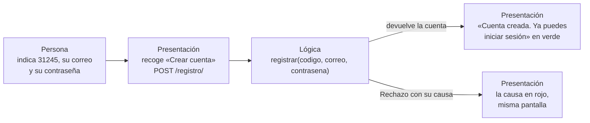
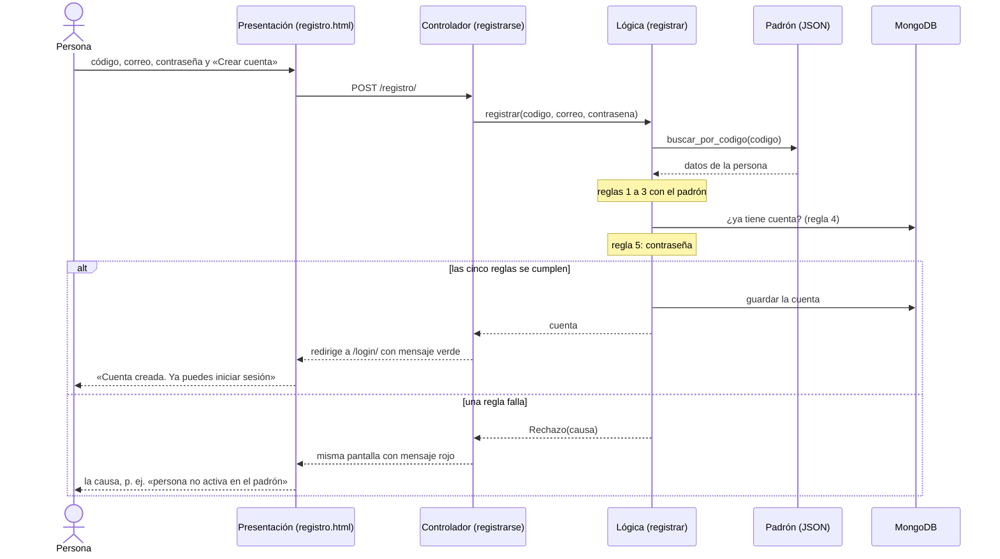
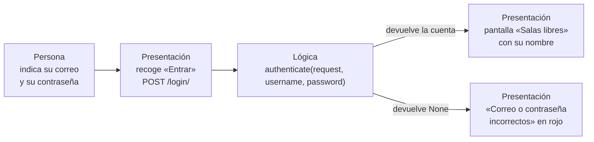
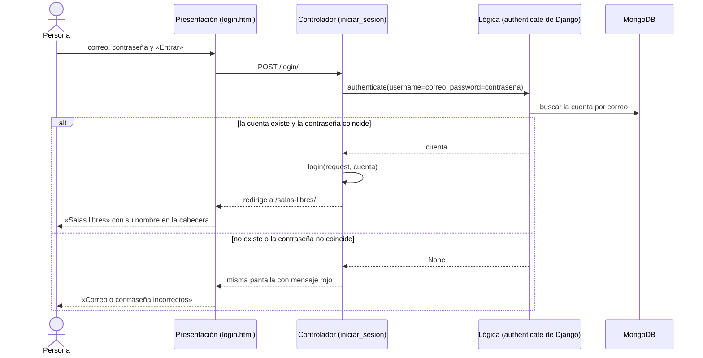

# Sesión 20 — Interfaz sencilla: registro e inicio de sesión

> Boceto (lámina 9) y recorrido de una acción (lámina 10) para **CU-01 Registrarse** y **CU-02 Iniciar sesión**, con la separación entre presentación y lógica que pide la sesión 20: *la lógica conserva la regla y la presentación comunica el resultado.*

| | |
|---|---|
| **Proyecto** | Reserva de Salas de Estudio — UPB Santa Cruz (P02) |
| **Casos de uso** | CU-01 Registrarse con el padrón (HU-01) · CU-02 Iniciar y cerrar sesión (HU-02) |
| **Base** | Código de `main`, commit `458dfd4` |
| **Fecha** | 21/10/2026 |
| **Relacionados** | [Criterios de aceptación](sesion-07-modelos.md) (sección 2) · [Diseño](sesion-13-14-diseno.md) · [Glosario](glosario.md) |

## En una mirada

| | CU-01 Registrarse | CU-02 Iniciar sesión |
|---|---|---|
| **Tarea de la persona** | Crear mi cuenta con los datos del padrón | Entrar al sistema con mi cuenta |
| **Acción** | Indicar código, correo y contraseña → **Crear cuenta** | Indicar correo y contraseña → **Entrar** |
| **Resultado útil** | Pasa a *Iniciar sesión* con «Cuenta creada. Ya puedes iniciar sesión» | Pasa a *Salas libres*, ya identificada |
| **Presentación** | `/registro/` · `templates/cuentas/registro.html` | `/login/` · `templates/cuentas/login.html` |
| **Controlador** | `cuentas/views.py` → `registrarse` | `cuentas/views.py` → `iniciar_sesion` |
| **Lógica** | `cuentas/servicios.py` → `registrar(codigo, correo, contrasena)` | Autenticación de Django → `authenticate(...)` |
| **Datos** | Padrón (`padron/padron.json`, solo lectura) y MongoDB | MongoDB (no consulta el padrón) |
| **Recorrido acordado** | FE → MW → Padrón → BD | FE → MW → BD |
| **Pruebas** | HU01-CA1 · HU01-CA2 | HU02-CA1 · HU02-CA2 |

---

## 1. CU-01 — Registrarse con el padrón

### 1.1 La tarea de la persona (lámina 2)

- **Tarea:** crear mi cuenta para poder reservar.
- **Acción:** indicar mi código, mi correo y una contraseña, y pulsar **Crear cuenta**.
- **Resultado útil:** saber que la cuenta quedó creada y poder iniciar sesión.

### 1.2 Boceto (lámina 9)

**A. Lo que ve al empezar** — una tarea, tres datos y una acción.

```text
┌──────────────────────────────────────────────────┐
│                                                  │
│  Crear cuenta                                    │
│                                                  │
│  Código                                          │
│  ┌────────────────────────────────────────────┐  │
│  │ 31245                                      │  │
│  └────────────────────────────────────────────┘  │
│  Correo                                          │
│  ┌────────────────────────────────────────────┐  │
│  │ valeria.rojas@upb.example                  │  │
│  └────────────────────────────────────────────┘  │
│  Contraseña                                      │
│  ┌────────────────────────────────────────────┐  │
│  │ ******************                         │  │
│  └────────────────────────────────────────────┘  │
│                                                  │
│  ┌────────────────────────────────────────────┐  │
│  │                Crear cuenta                │  │
│  └────────────────────────────────────────────┘  │
│                 Ya tengo cuenta                  │
│                                                  │
└──────────────────────────────────────────────────┘
```

**B. Resultado «listo»** — pasa a *Iniciar sesión* y el mensaje verde dice qué se obtuvo.

```text
┌──────────────────────────────────────────────────┐
│                                                  │
│  ┌─ mensaje verde ────────────────────────────┐  │
│  │ Cuenta creada. Ya puedes iniciar sesión    │  │
│  └────────────────────────────────────────────┘  │
│                                                  │
│  Iniciar sesión                                  │
│                                                  │
│  Correo                                          │
│  ┌────────────────────────────────────────────┐  │
│  │                                            │  │
│  └────────────────────────────────────────────┘  │
│  Contraseña                                      │
│  ┌────────────────────────────────────────────┐  │
│  │                                            │  │
│  └────────────────────────────────────────────┘  │
│                                                  │
│  ┌────────────────────────────────────────────┐  │
│  │                   Entrar                   │  │
│  └────────────────────────────────────────────┘  │
│                   Crear cuenta                   │
│                                                  │
└──────────────────────────────────────────────────┘
```

**C. Resultado «error»** — se queda en *Crear cuenta* y el mensaje rojo dice por qué no se completó (Diego, 31248, está inactivo).

```text
┌──────────────────────────────────────────────────┐
│                                                  │
│  ┌─ mensaje rojo ─────────────────────────────┐  │
│  │ persona no activa en el padrón             │  │
│  └────────────────────────────────────────────┘  │
│                                                  │
│  Crear cuenta                                    │
│                                                  │
│  Código                                          │
│  ┌────────────────────────────────────────────┐  │
│  │                                            │  │
│  └────────────────────────────────────────────┘  │
│  Correo                                          │
│  ┌────────────────────────────────────────────┐  │
│  │                                            │  │
│  └────────────────────────────────────────────┘  │
│  Contraseña                                      │
│  ┌────────────────────────────────────────────┐  │
│  │                                            │  │
│  └────────────────────────────────────────────┘  │
│                                                  │
│  ┌────────────────────────────────────────────┐  │
│  │                Crear cuenta                │  │
│  └────────────────────────────────────────────┘  │
│                 Ya tengo cuenta                  │
│                                                  │
└──────────────────────────────────────────────────┘
```

### 1.3 Recorrido de una acción (lámina 10)

```text
┌─────────────────────────────────┐        ┌─────────────────────────────────┐
│ Persona                         │        │ Presentación                    │
│ indica 31245, su correo y su    │  ───>  │ recoge la acción «Crear cuenta» │
│ contraseña                      │        │ POST /registro/                 │
└─────────────────────────────────┘        └─────────────────────────────────┘
                                                            │
                                                            v
┌─────────────────────────────────┐        ┌─────────────────────────────────┐
│ Presentación                    │        │ Lógica de aplicación            │
│ muestra «Cuenta creada. Ya      │  <───  │ registrar("31245",              │
│ puedes iniciar sesión»          │        │   "valeria.rojas@upb.example",  │
└─────────────────────────────────┘        │   "…")                          │
                                           └─────────────────────────────────┘
```



| Paso | Capa | Qué ocurre | Dónde |
|---|---|---|---|
| 1 | Persona | Escribe 31245, `valeria.rojas@upb.example` y su contraseña; pulsa **Crear cuenta** | Navegador |
| 2 | Presentación | El formulario envía `POST /registro/` con `codigo`, `correo` y `contrasena` | `registro.html` |
| 3 | Controlador | Toma los tres datos y llama a la lógica; no aplica ninguna regla | `views.registrarse` |
| 4 | Lógica | Busca el código en el padrón, aplica las 5 reglas y guarda la cuenta | `servicios.registrar` y `reservas/reglas.py` |
| 5 | Controlador | Si todo va bien: mensaje verde y redirige a `/login/`. Si hay `Rechazo`: mensaje rojo con su causa, misma pantalla | `views.registrarse` |
| 6 | Presentación | Muestra el mensaje en verde o en rojo | `base.html` |

### 1.4 Dentro de la lógica: las cinco reglas, en orden

Si una regla falla, la lógica se detiene ahí y devuelve un `Rechazo` con su causa.

| # | Regla | Función | Causa que ve la persona |
|---|---|---|---|
| 1 | El código existe en el padrón | `verificar_persona_en_padron` | «código no encontrado en el padrón» |
| 2 | El correo es el de ese código (sin distinguir mayúsculas) | `verificar_correo_del_padron` | «el correo no corresponde a ese código» |
| 3 | La persona está activa | `verificar_persona_activa` | «persona no activa en el padrón» |
| 4 | La persona aún no tiene cuenta | `verificar_sin_cuenta` | «ya tienes una cuenta» |
| 5 | La contraseña es válida: 8 caracteres o más, no común, no solo números y no parecida al correo ni al nombre | `verificar_contrasena` | El mensaje de Django, p. ej. «La contraseña es demasiado corta. Debe contener por lo menos 8 caracteres.» |

Si las cinco se cumplen, la cuenta se crea con el rol, el nivel y la matrícula copiados del padrón (decisión D-01) y se guarda en MongoDB. **El padrón no se modifica.**



---

## 2. CU-02 — Iniciar y cerrar sesión

### 2.1 La tarea de la persona (lámina 2)

- **Tarea:** entrar al sistema con mi cuenta.
- **Acción:** indicar mi correo y mi contraseña, y pulsar **Entrar**.
- **Resultado útil:** llegar a *Salas libres* ya identificada, con mi nombre en la cabecera.

### 2.2 Boceto (lámina 9)

**A. Lo que ve al empezar.**

```text
┌──────────────────────────────────────────────────┐
│                                                  │
│  Iniciar sesión                                  │
│                                                  │
│  Correo                                          │
│  ┌────────────────────────────────────────────┐  │
│  │ valeria.rojas@upb.example                  │  │
│  └────────────────────────────────────────────┘  │
│  Contraseña                                      │
│  ┌────────────────────────────────────────────┐  │
│  │ ******************                         │  │
│  └────────────────────────────────────────────┘  │
│                                                  │
│  ┌────────────────────────────────────────────┐  │
│  │                   Entrar                   │  │
│  └────────────────────────────────────────────┘  │
│                   Crear cuenta                   │
│                                                  │
└──────────────────────────────────────────────────┘
```

**B. Resultado «listo»** — el resultado es el cambio de pantalla: aparece la cabecera con su nombre y el menú.

```text
┌──────────────────────────────────────────────────┐
│  Salas libres   Mis reservas                     │
│  Valeria Rojas (estudiante)   [ Cerrar sesión ]  │
│  ──────────────────────────────────────────────  │
│                                                  │
│  Salas libres                                    │
│                                                  │
│  (aquí sigue la consulta de salas de HU-03)      │
│                                                  │
└──────────────────────────────────────────────────┘
```

**C. Resultado «error»** — un único mensaje, a propósito: no dice si falló el correo o la contraseña (RF-14).

```text
┌──────────────────────────────────────────────────┐
│                                                  │
│  ┌─ mensaje rojo ─────────────────────────────┐  │
│  │ Correo o contraseña incorrectos            │  │
│  └────────────────────────────────────────────┘  │
│                                                  │
│  Iniciar sesión                                  │
│                                                  │
│  Correo                                          │
│  ┌────────────────────────────────────────────┐  │
│  │                                            │  │
│  └────────────────────────────────────────────┘  │
│  Contraseña                                      │
│  ┌────────────────────────────────────────────┐  │
│  │                                            │  │
│  └────────────────────────────────────────────┘  │
│                                                  │
│  ┌────────────────────────────────────────────┐  │
│  │                   Entrar                   │  │
│  └────────────────────────────────────────────┘  │
│                   Crear cuenta                   │
│                                                  │
└──────────────────────────────────────────────────┘
```

### 2.3 Recorrido de una acción (lámina 10)

```text
┌─────────────────────────────────┐        ┌─────────────────────────────────┐
│ Persona                         │        │ Presentación                    │
│ indica su correo y su           │  ───>  │ recoge la acción «Entrar»       │
│ contraseña                      │        │ POST /login/                    │
└─────────────────────────────────┘        └─────────────────────────────────┘
                                                            │
                                                            v
┌─────────────────────────────────┐        ┌─────────────────────────────────┐
│ Presentación                    │        │ Lógica de aplicación            │
│ muestra la pantalla             │  <───  │ authenticate(request,           │
│ «Salas libres», ya identificada │        │   username="valeria.rojas@…",   │
└─────────────────────────────────┘        │   password="…")                 │
                                           └─────────────────────────────────┘
```



| Paso | Capa | Qué ocurre | Dónde |
|---|---|---|---|
| 1 | Persona | Escribe su correo y su contraseña; pulsa **Entrar** | Navegador |
| 2 | Presentación | El formulario envía `POST /login/` con `correo` y `contrasena` | `login.html` |
| 3 | Controlador | Llama a `authenticate` con el correo como nombre de usuario | `views.iniciar_sesion` |
| 4 | Lógica | Busca la cuenta por correo en MongoDB y compara la contraseña cifrada | Autenticación de Django |
| 5 | Controlador | Si hay cuenta: `login(...)` abre la sesión y redirige a `/salas-libres/`. Si no: mensaje rojo único | `views.iniciar_sesion` |
| 6 | Presentación | Muestra *Salas libres* con la cabecera, o el mensaje rojo | `salas_libres.html` · `base.html` |

### 2.4 Dentro de la lógica

- **No consulta el padrón:** el inicio de sesión solo usa la cuenta ya creada en MongoDB.
- **Mensaje único (RF-14):** «Correo o contraseña incorrectos», tanto si el correo no existe como si la contraseña está mal. Así no revela qué correos tienen cuenta.
- **Cerrar sesión:** el botón **Cerrar sesión** de la cabecera envía `POST /logout/`. La sesión se cierra y la persona vuelve a *Iniciar sesión*.



---

## 3. El contrato de comunicación (lámina 6)

La presentación y la lógica solo se conocen a través de este contrato.

| Contrato | CU-01 Registrarse | CU-02 Iniciar sesión |
|---|---|---|
| **Petición HTTP** | `POST /registro/` con `codigo`, `correo` y `contrasena`, más el token CSRF | `POST /login/` con `correo` y `contrasena`, más el token CSRF |
| **Llamada a la lógica** | `registrar(codigo, correo, contrasena)` | `authenticate(request, username=correo, password=contrasena)` |
| **Si todo va bien** | Devuelve la cuenta creada | Devuelve la cuenta; el controlador llama a `login(...)` |
| **Si no** | Lanza `Rechazo` con `causa`, un texto pensado para la persona | Devuelve `None` |
| **Pantalla siguiente** | `/login/` con mensaje verde, o la misma con mensaje rojo | `/salas-libres/`, o la misma con mensaje rojo |

### 3.1 Evidencia: la presentación cambió; el contrato y la regla, no (láminas 3 y 6)

En la fase 8 las dos pantallas se rediseñaron con Tailwind, en los commits `f73c52c` (base e inicio de sesión) y `16a81db` (registro), ambos del 18/10/2026. Se cambiaron 42 líneas y se quitaron 17. Comparado con Git, antes (`dab355c`) y después (`458dfd4`):

| Pantalla | Campos antes | Campos después | ¿Cambió la lógica? |
|---|---|---|---|
| `registro.html` | `codigo`, `correo`, `contrasena` | `codigo`, `correo`, `contrasena` | No: `servicios.py` y `views.py` no se tocaron |
| `login.html` | `correo`, `contrasena` | `correo`, `contrasena` | No |

Es el principio de la lámina 3: **la interacción visible puede cambiar aunque la regla se conserve.** Y el de la lámina 6: para cambiar la pantalla sin adaptar el servidor, se conservó el contrato.

---

## 4. Modelo, vista y controlador en nuestro proyecto (láminas 11 y 12)

| Rol | Responsabilidad conceptual | En nuestro código |
|---|---|---|
| **Modelo** | Representa el estado y el comportamiento | `Usuario` (`cuentas/models.py`), `registrar` (`cuentas/servicios.py`), las reglas (`reservas/reglas.py`) y el padrón (`cuentas/padron.py`, `padron/padron.json`) |
| **Vista** | Presenta la información a la persona | `registro.html`, `login.html` y `base.html`, que pinta los mensajes en verde o en rojo |
| **Controlador** | Interpreta acciones y coordina respuestas | `registrarse`, `iniciar_sesion` y `cerrar_sesion` (`cuentas/views.py`), con las rutas de `cuentas/urls.py` |

> En Django los nombres engañan: lo que el framework llama *vista* (`views.py`) cumple el rol de **controlador**, y lo que llama *plantilla* cumple el de **vista**. Por eso la sigla no define una única organización (lámina 11). Y el modelo no es solo la base de datos: también incluye las reglas (lámina 12).

---

## 5. Una regla, dos representaciones (láminas 8 y 13)

**Supuesto:** Valeria (31245) está activa en el padrón y no tiene cuenta; Diego (31248) está inactivo.

| Representación | Solicitud | Salida visible |
|---|---|---|
| Terminal (prueba HU01-CA1) | `servicios.registrar("31245", "valeria.rojas@upb.example", "…")` | Una cuenta con `codigo="31245"`, `rol="estudiante"` y `nivel="pregrado"` |
| Interfaz visual | Formulario **Crear cuenta** con esos datos | «Cuenta creada. Ya puedes iniciar sesión» |
| Terminal (prueba HU01-CA2) | `servicios.registrar("31248", "diego.vargas@upb.example", "…")` | `Rechazo` con la causa «persona no activa en el padrón» |
| Interfaz visual | Formulario **Crear cuenta** con los datos de Diego | Mensaje rojo «persona no activa en el padrón» |

La lógica responde lo mismo en los dos casos; solo cambia cómo se muestra. **La regla no está duplicada en la plantilla:** las dos representaciones usan la misma función, y por eso se puede probar por separado (lámina 13).

---

## 6. Mensajes y comprensión (lámina 15)

| Mensaje exacto | Color | Dónde aparece | Qué le dice a la persona |
|---|---|---|---|
| «Cuenta creada. Ya puedes iniciar sesión» | Verde | Iniciar sesión | **Listo:** obtuvo su cuenta, y el siguiente paso es entrar |
| «código no encontrado en el padrón» | Rojo | Crear cuenta | **Error:** no se creó; el código no existe |
| «el correo no corresponde a ese código» | Rojo | Crear cuenta | **Error:** no se creó; el correo y el código no coinciden |
| «persona no activa en el padrón» | Rojo | Crear cuenta | **Error:** no se creó; la persona no está activa |
| «ya tienes una cuenta» | Rojo | Crear cuenta | **Error:** no se creó; debe iniciar sesión |
| Mensajes de contraseña de Django, p. ej. «La contraseña es demasiado corta. Debe contener por lo menos 8 caracteres.» | Rojo | Crear cuenta | **Error:** no se creó; la contraseña no cumple las reglas |
| «Correo o contraseña incorrectos» | Rojo | Iniciar sesión | **Error:** no entró; a propósito no dice qué falló (RF-14) |

Un inicio de sesión correcto no muestra mensaje: el resultado visible es el cambio a *Salas libres* con el nombre en la cabecera.

---

## 7. Diseño centrado en la persona (láminas 14 y 19)

| Pregunta | CU-01 Registrarse | CU-02 Iniciar sesión |
|---|---|---|
| ¿Se entiende qué puede hacer? | Título «Crear cuenta» y tres campos con etiqueta | Título «Iniciar sesión» y dos campos con etiqueta |
| ¿Reconoce el resultado de su acción? | Mensaje verde en la pantalla siguiente, o rojo con la causa | Cambia a «Salas libres» con su nombre; si falla, mensaje rojo |
| ¿Puede decidir cómo continuar? | Llega a *Iniciar sesión*; enlace «Ya tengo cuenta» | Enlace «Crear cuenta»; botón «Cerrar sesión» en la cabecera |

**Preguntas que abre el boceto.** Son mejoras posibles, no están implementadas:

1. Tras un rechazo, el formulario vuelve vacío y hay que escribir todo de nuevo, porque la vista no devuelve lo escrito.
2. La etiqueta «Código» no dice qué código es: es el del padrón de la universidad.
3. Las reglas de la contraseña solo se conocen después de un rechazo.
4. En el inicio de sesión, el mensaje único es intencional (RF-14): no conviene «mejorarlo» diciendo qué falló.

Las tres primeras se resuelven en la presentación, sin tocar la lógica. Es la idea de la lámina 19: *una pantalla nueva no garantiza una tarea clara.*

---

## 8. Evidencia (láminas 16 a 18)

### 8.1 Pruebas de lógica, que ya existen

| Prueba | Qué comprueba | Por dónde entra |
|---|---|---|
| `test_HU01_CA1_registra_cuenta_con_codigo_y_correo_del_padron` | Crea la cuenta con los datos del padrón, la cuenta puede autenticarse y el padrón no cambia | Llama directo a `servicios.registrar`: la lógica |
| `test_HU01_CA2_rechaza_registro_de_persona_inactiva` | Rechaza a Diego con «persona no activa en el padrón» y no crea ninguna cuenta | `servicios.registrar`: la lógica |
| `test_HU02_CA1_inicia_sesion_con_correo_y_contrasena` | Entra con su correo y su contraseña, queda identificada como 31245 y su cuenta no cambia | `POST /login/` con el cliente de pruebas de Django: el controlador |
| `test_HU02_CA2_contrasena_incorrecta_da_mensaje_unico` | Con contraseña incorrecta y con correo inexistente recibe el mismo mensaje, y no entra | `POST /login/`: el controlador |

Las cuatro corren en el CI de GitHub Actions junto con las otras 22: **26 passed**. Las de HU-02 ya cruzan la frontera HTTP, pero ninguna mira la pantalla. Como dice la lámina 16, que una prueba de lógica pase no muestra por sí sola qué ve o puede hacer la persona.

### 8.2 Prueba a través de la interfaz (lámina 17)

Se hace en el navegador con `python manage.py runserver`. Marca `[x]` en «Observado» cuando lo veas.

| # | Estado inicial | Acción | Resultado visible esperado | Observado |
|---|---|---|---|---|
| 1 | Valeria activa en el padrón, sin cuenta | 31245, `valeria.rojas@upb.example` y una contraseña válida → **Crear cuenta** | Pantalla «Iniciar sesión» con el mensaje verde «Cuenta creada. Ya puedes iniciar sesión» | [ ] |
| 2 | Diego inactivo en el padrón | 31248, `diego.vargas@upb.example` y una contraseña → **Crear cuenta** | Sigue en «Crear cuenta» con el mensaje rojo «persona no activa en el padrón» | [ ] |
| 3 | Valeria con cuenta | Su correo y su contraseña → **Entrar** | Pantalla «Salas libres» con «Valeria Rojas (estudiante)» en la cabecera | [ ] |
| 4 | Valeria con cuenta | Su correo y una contraseña incorrecta → **Entrar** | Sigue en «Iniciar sesión» con el mensaje rojo «Correo o contraseña incorrectos» | [ ] |

### 8.3 Alcance de la evidencia (lámina 18)

- Un resultado correcto no demuestra toda la interfaz.
- No establece compatibilidad con todos los navegadores o dispositivos.
- No demuestra que personas reales comprendan el flujo.
- Los cuatro escenarios delimitan lo comprobado: un camino de éxito y uno de error por caso de uso.

---

## 9. Una interfaz con evidencia (lámina 20)

| Criterio | ¿Se cumple? | Dónde |
|---|---|---|
| Tarea de usuario explícita | Sí | Secciones 1.1 y 2.1 |
| Presentación y lógica separadas | Sí | Secciones 3, 4 y 5 |
| Contrato de colaboración claro | Sí | Sección 3 |
| Resultado visible comprensible | Sí, con tres mejoras posibles | Secciones 6 y 7 |
| Pruebas de lógica y de interfaz complementarias | Lógica: sí, en el CI. Interfaz: cuatro escenarios para observar | Sección 8 |

> **¿Qué cambió en la presentación y cómo verificamos el comportamiento esperado?**
> Cambió el aspecto de las dos pantallas (Tailwind, fase 8); el contrato y la lógica no cambiaron. El comportamiento se verifica con las cuatro pruebas de lógica, en verde en el CI, y con los cuatro escenarios por la interfaz de la sección 8.2.

---

## Participación y asistencia

- **Hugo Zúñiga:** eligió los dos casos de uso (registro e inicio de sesión) y aprobó el enfoque del boceto y del recorrido.
- **Asistencia de IA:** Claude (Anthropic) redactó este documento a partir del código de `main` (`458dfd4`). Comprobó los mensajes y las rutas ejecutando la lógica sin base de datos, y verificó con Git que el rediseño conservó los nombres de los campos.
